# OBIEE → Power BI Migration Assistant

A deterministic Python extractor that reads an OBIEE repository and produces the **Estate Knowledge Base** — CSV tables capturing every metric's exact logic, its full lineage to physical tables, and the metadata that silently breaks numeric parity when missed.

**No LLM participates in extraction.** Identical input produces byte-identical output.

This repository currently contains **Epic 1 (repository extraction)** and **Epic 2 (Web Catalog extraction)** — the semantic layer and the report layer. Downstream migration (Migration Spine, Group Spec, Power BI generation, parity validation) is not built yet.

---

## Requirements

**Python 3.11 or newer. That is the entire list.**

```sh
python3 --version   # must be >= 3.11
```

Nothing to install: no `pip install`, no virtualenv, no build step, no service. The extractor imports only the standard library — a hard architectural rule, and a test asserts it. If your `python3` is older, call a newer one explicitly: `python3.12 -m tools.rpd_extract.cli …`

---

## What input it needs

An **estate** — a repository, a Web Catalog, or both. Put each half in a folder named for what it is:

```
your-estate/
  rpd/       oracle/bi/server/base/…      the repository, as MDS XML
  catalog/   00. va projects/ …           the Web Catalog, copied as-is
```

```sh
python3 -m tools.rpd_extract.cli --corpus your-estate --rpd-id my-estate --out /tmp/kb
```

**Either half may be absent**, and the manifest records which were present — so *"this estate has no dashboards"* and
*"dashboards were not extracted"* stay distinguishable. Both halves under one `rpd-id` is how you **declare** they belong to
the same estate; the tool never infers that from matching Subject Area names (AD-22).

A bare repository tree still works exactly as before — see *Run it on your repository* below.

### If you have a BAR archive

A BAR is a zip, and **it is not a ready pair**. Unzip it, then:

| From the BAR | Goes to | Note |
|---|---|---|
| `content/catalog/` | `your-estate/catalog/` | usable as-is |
| `datamodel/rpd/default.rpd` | `your-estate/rpd/` | **binary — convert it first** |

The `.rpd` inside a BAR is Oracle's proprietary binary format, which this tool does not read. Convert it to MDS XML with
`biserverxmlgen` (below) and put the result in `rpd/`. There is deliberately **no BAR code path**: a BAR is an unpacking step
in front of the two formats already understood, and modelling it as a third would be building for a format nobody asked us to
read.

### The repository half

**MDS XML** — OBIEE's exploded repository format, one XML file per object:

```
<your-repository>/
  oracle/bi/server/base/
    PhysicalTable/<guid>.xml
    LogicalTable/<guid>.xml
    LogicalTableSource/<guid>.xml
    PresentationCatalog/<guid>.xml
    …
```

If you have a directory shaped like that, you are ready.

### Converting your `.rpd` to MDS XML

Two ways. Both produce the same thing: one XML file per repository object.

#### Option A — Administration Tool (GUI)

1. **Open the repository in offline mode.** MDS XML is only offered offline — if the repository is open online, the menu option will not appear.
2. **File → Save As → MDS XML Documents**, and choose an output directory.
3. On first opening the result, the Administration Tool asks whether it is a **standalone MDS XML repository** or **under source control**. Either answer works for this tool; it only reads files.

#### Option B — `biserverxmlgen` (command line)

Ships with the OBIEE server and with the BI Client Tools install. On the server it is typically under `$ORACLE_HOME/bi/bifoundation/server/bin` (Linux) or `%ORACLE_HOME%\bi\bifoundation\server\bin` (Windows).

```sh
biserverxmlgen -R /path/to/your.rpd -D /path/to/output-dir -M -8
```

| Flag | Meaning | Why |
|---|---|---|
| `-R` | source `.rpd` | |
| `-D` | output **directory** | one file per object — this is what makes it MDS XML |
| `-M` | MDS XML format | **required.** Without it you get a single XUDML file, which this tool does not read |
| `-8` | UTF-8 output | matches the encoding the extractor expects |
| `-P` | repository password | see the warning below |

**Both `-M` and `-D` are needed.** `-M` alone with `-O` writes one big MDS file; `-D` alone without `-M` writes plain XUDML. Only `-M -D` together give the exploded per-object layout.

> **⚠️ Do not pass `-Q`.** It generates the script *without security objects*, which silently discards the application roles, privileges and row-level filters this tool extracts for FR-4. You would get a clean-looking export missing your entire security layer — exactly the kind of silent omission the product is designed to catch. Likewise `-S` gives you *only* security objects.

> **⚠️ Credentials.** Passing `-P <password>` puts your repository password into shell history and into the process list where other users can see it. Omit `-P` and let the utility prompt, or use your platform's secret handling. This tool never sees, stores, or needs the password — it reads already-exported files.


---

## Run it on your repository

```sh
cd /path/to/POC-RPD

python3 -m tools.rpd_extract.cli \
  --corpus /path/to/your-repository \
  --rpd-id my-estate \
  --out /tmp/kb
```

```
rpd-ids:  my-estate
parsed:   21 objects
skipped:  0 objects  -> /tmp/kb/unparsed.csv
written:  /tmp/kb
```

**`--corpus`** points at the directory containing `oracle/bi/server/base/`.

**`--rpd-id`** is the name **you** choose for this repository. It becomes the permanent prefix of every identifier the tool produces — `my-estate::bmm::Sales.Fact.Revenue` — so a Group Spec or a parity check can cite a row unambiguously.

Pick it deliberately. Lower-kebab (`my-estate`, `prod-rpd`), and **stable**: changing it later invalidates every citation that used it. The tool will never invent one for you, and never derives it from a filename, a timestamp, or a hash — that is the point of it being an argument.

### Resetting the Knowledge Base

Re-running **overwrites every table**, so a normal refresh needs no cleanup — switching
from a 6000-object estate to a 20-object one leaves no residue from the first.

The one case that needs care: a table the current extractor no longer writes **survives**
a plain re-run, and a stale table in a Knowledge Base looks perfectly legitimate. So after
changing the extractor's table set, rebuild from empty:

```sh
python3 -m tools.rpd_extract.cli --corpus <yours> --rpd-id my-estate --out estate/knowledge-base --clean
```

`--clean` **refuses to run** unless the directory is empty or already contains
`manifest.csv` — proof this extractor wrote it. Without that check, pointing `--out` at
the wrong directory would delete every CSV in it. Non-CSV content is never touched, so a
`.gitignore` or a subdirectory survives.

Consumers should read the table list from `manifest.csv` rather than listing the
directory. Then a stale file is invisible to them and this question stops mattering.

### More than one repository

Put each under its own directory, named for its `rpd-id`, and drop the flag:

```
estates/
  prod-rpd/oracle/bi/server/base/…
  legacy-rpd/oracle/bi/server/base/…
```

```sh
python3 -m tools.rpd_extract.cli --corpus estates --out /tmp/kb
```

Identically-named objects from different repositories stay distinct — `prod-rpd::bmm::Sales.Revenue` and `legacy-rpd::bmm::Sales.Revenue` are two measures, not one. Merging them is a human decision the tool refuses to make for you.

---

## Try it first, without your own data

Five OBIEE constructs are committed to this repository, so you can see it work before pointing it at anything of yours:

```sh
python3 -m tools.rpd_extract.cli \
  --corpus estate/test-corpus/constructed-cases/constructed \
  --rpd-id demo \
  --out /tmp/demo

ls /tmp/demo
column -s, -t < /tmp/demo/aggregation_rules.csv | cut -c1-120
```

Expect `parsed: 21`, `skipped: 0`. Run the test suite too:

```sh
python3 -m unittest discover -s tools/rpd_extract/tests -t .   # Ran 168 tests … OK
```

Tests that need the large development corpora **skip** when those are absent, rather than passing quietly on missing input.

There is also a larger public corpus used to develop the tool — 1383 files across two real repositories. Setup is in `estate/test-corpus/corpus.md`; you do not need it to use the extractor on your own estate.

---

## What you get

`--out` receives one CSV per concern. Row counts below are from the development corpus — a 1383-file repository half and a
5371-file Web Catalog half — to give a sense of scale:

| Table | Rows | What it holds |
|---|---|---|
| `physical_tables` / `physical_columns` | 100 / 1096 | Source database objects. `source_table_id` names the table an **alias** stands for — 8 of the 100 |
| `physical_table_definitions` | 44 | What a physical table is in the database, **verbatim**: an opaque view's SQL (21), or the database name of an ordinary table (23), per database type. Never parsed |
| `physical_joins` | 104 | Foreign keys and complex joins |
| `logical_tables` / `logical_columns` | 82 / 1010 | Metric definitions, **formulas verbatim** |
| `aggregation_rules` | 35 | One row per rule; overrides never collapsed |
| `presentation_subject_areas` / `_tables` / `_columns` | 21 / 128 / 1543 | What report authors see |
| `presentation_hierarchies` / `_levels` / `_level_columns` | 58 / 246 / 199 | **Drill paths** — hierarchies, their levels in order, and the column shown at each |
| `logical_dimensions` / `logical_levels` | 25 / 106 | Drill semantics — **ragged, skip-level and parent-child** are carried, not flattened |
| `logical_table_sources` / `lts_column_map` | 92 / 1035 | How logical maps to physical |
| `lineage` | 1573 | **presentation → logical → source → physical** |
| `bmm_joins` | 84 | Join types, inner vs outer |
| `variables` / `init_blocks` | 345 / 154 | Session and repository variables |
| `security_rls` | 198 | Roles, privileges, row-level predicates |
| `dashboards` / `dashboard_pages` | 111 / 1036 | Dashboards and their pages, in order |
| `dashboard_contents` | 3718 | What is placed on each page, **and how each reference resolved** |
| `analyses` / `analysis_criteria` | 1607 / 1789 | Reports, and every query block in them |
| `analysis_columns` | 11143 | Report columns, **formulas verbatim** — 10340 carry one |
| `analysis_views` | 10879 | **What each report renders as** — chart, pivot, table, gauge, map — in order |
| `report_lineage` | 11143 | **Report column → semantic layer** (FR-7). One row per Analysis column, resolved or with the reason it was not |
| `analysis_filters` | 7135 | Filter expressions, dashboard- and Analysis-scope |
| `analysis_prompts` | 4 | Prompts and the variables they set — **see the note below** |
| `saved_filters` | 96 | Filters stored for reuse |
| `catalog_versions` | — | `xmlVersion` per object type, **absence counted as a value** |
| `coverage` | — | Objects parsed and skipped, per type **and layer** |
| `coverage_summary` | — | **What share of the input was modelled**, in whole numbers |
| `unparsed` | 1434 | **Known gaps** — content not modelled, and how much of it |
| `errors` | 1556 | **Things that went wrong** — kept separate on purpose. **All 1556 are unresolved references**, almost all into `/company_shared/`, a catalog root this fixture does not contain |
| `manifest` | — | Source, timestamp, extractor version |

### `unparsed.csv` and `errors.csv` — read both, they answer different questions

**`errors.csv` is the one to read first.** Something that should have been captured was not: malformed XML, a reference that would not resolve, an object with no name, a directory that could not be read, or an identifier that names more than one row (`duplicate_identifier` — FR-8 requires an identifier cited from a Group Spec to resolve to exactly one row, and identifiers are built from names that OBIEE does not make unique). Each row names the source object, the kind, and the reason. **An empty `errors.csv` is the good outcome.** The CLI exits `3` when it is non-empty, so it is scriptable.

**`unparsed.csv` is known gaps, and a healthy file is not empty.** Four kinds:

| `kind` | Meaning |
|---|---|
| `undiscovered_file` | A file under the corpus root that discovery never picked up. **Should be zero** |
| `unmodelled_type` | An object type no parser has been written for. Expected |
| `unread_attribute` | An attribute present on an object we *did* parse, that no column carries |
| `unread_element` | Same, for a child element |
| `unread_text` | Same, for an element's text content |
| `not_a_catalog_object` | A file in the catalog tree that was never a catalog object — a PNG, an RTF template, a PDF. **Catalog objects are extensionless, so every file must be attempted**; classifying these is what keeps 1030 of them out of `errors.csv` |
| `excluded_by_scope` | Styling and formatting attributes, out of scope per FR-34. **Recorded rather than dropped**, because an exclusion that leaves no trace cannot be told from an oversight |

The last three matter more than they look. **An object can parse "successfully" while attributes, elements and text on it are discarded silently** — the same failure NFR7 names as primary, one level below where AD-3 was watching. On the development corpus that is **1139 distinct items across 421,571 occurrences**, including the SQL that defines `select`-type views.

It is also the **format-drift detector**. A repository from a different OBIEE version carrying new attributes announces itself here instead of being quietly dropped — which is the honest answer to "will this work on my estate?"

**How the audit knows.** It does not consult a list of what the parsers are supposed to read. It **observes what they actually read**, during the run, and reports the difference against what the file contained. That distinction is not academic: the audit was previously driven by a hand-maintained declaration, and six of its entries had drifted from the code. One of them, `PrivilegePackage@userRef`, silenced three privilege grants made to named users — the file reported as fully understood while the data was dropped. A declaration records an intention and can disagree with the code; an observation cannot.

The remaining failure mode is the harmless one: a branch your estate exercises and the development corpus never did may report a gap that turns out to be read after all. Noise, not silence.

---


## How the tables connect

Every foreign key below was verified against the real corpus — the counts in
brackets are how many rows resolved out of how many were present.

```mermaid
erDiagram
    physical_tables   ||--o{ physical_columns : "table_id (1096/1096)"
    physical_tables   ||--o{ physical_joins   : "table1_id (104/104)"
    physical_tables   |o--o{ physical_tables  : "source_table_id, aliases (8/8)"
    physical_tables   ||--o{ physical_table_definitions : "table_id (44/44)"

    logical_tables    ||--o{ logical_columns       : "table_id (1010/1010)"
    logical_tables    ||--o{ logical_table_sources : "logical_table_id (92/92)"
    logical_tables    ||--o{ bmm_joins             : "table1_id / table2_id (84/84)"
    logical_columns   ||--o{ aggregation_rules     : "logical_column_id (35/35)"

    logical_table_sources ||--o{ lts_column_map : "source_id (1035/1035)"
    logical_columns       ||--o{ lts_column_map : "logical_column_id (1035/1035)"
    physical_columns      ||--o{ lts_column_map : "physical_column_id (1035/1035)"

    presentation_subject_areas ||--o{ presentation_tables  : "subject_area_id (128/128)"
    presentation_tables        ||--o{ presentation_columns : "table_id (1543/1543)"
    logical_columns            ||--o{ presentation_columns : "logical_column_id (1543/1543)"
    logical_columns            |o--o| presentation_subject_areas : "implicit_fact_column_id (1/1)"

    presentation_tables      ||--o{ presentation_hierarchies   : "table_id (58/58)"
    presentation_hierarchies ||--o{ presentation_levels        : "hierarchy_id (246/246)"
    presentation_levels      ||--o{ presentation_level_columns : "level_id (199/199)"
    presentation_columns     ||--o{ presentation_level_columns : "presentation_column_id (199/199)"
    logical_dimensions       ||--o{ logical_levels             : "dimension_id (106/106)"
    logical_levels           ||--o{ presentation_levels        : "logical_level_id (246/246)"

    presentation_columns  ||--o{ lineage : "presentation_column_id (1573/1573)"
    logical_columns       ||--o{ lineage : "logical_column_id (1573/1573)"
    logical_table_sources ||--o{ lineage : "source_id (1573/1573)"
    physical_tables       ||--o{ lineage : "physical_table_id (1573/1573)"
    physical_columns      ||--o{ lineage : "physical_column_id (1573/1573)"

    init_blocks ||--o{ variables : "init_block_id (272/272)"

    dashboards      ||--o{ dashboard_pages    : "dashboard_id (1030/1030)"
    dashboards      ||--o{ dashboard_contents : "container_id, pages (1041)"
    dashboard_pages ||--o{ dashboard_contents : "container_id, placements (2677)"

    analyses          ||--o{ analysis_criteria : "analysis_id (1789/1789)"
    analyses          ||--o{ analysis_columns  : "analysis_id (11143/11143)"
    analysis_criteria ||--o{ analysis_columns  : "criteria_id (11143/11143)"
    analyses          ||--o{ analysis_prompts  : "analysis_id (4/4)"
    analyses          ||--o{ analysis_views    : "analysis_id (10879/10879)"

    analyses        ||--o{ analysis_filters : "owner_id, scope=analysis (6248)"
    dashboard_pages ||--o{ analysis_filters : "owner_id, scope=dashboard (887)"

    analyses      |o--o{ dashboard_contents : "target_id (2161/2728)"
    saved_filters |o--o{ dashboard_contents : "target_id (same key)"

    presentation_subject_areas |o..o{ analysis_criteria : "subject_area, BY NAME (0/1680)"

    analysis_columns           ||--|| report_lineage : "analysis_column_id (11143/11143)"
    presentation_columns       |o..o{ report_lineage : "presentation_column_id (0/5806)"
```



### Reading it

**`lineage` is a materialised join, not an entity.** It is the only table touching all
four layers at once, and it exists so "where does this number come from" is one lookup
instead of a five-way join you have to get right yourself. Every other table is an
entity plus its own foreign keys.

**The three layers stack downward**, and each is reachable from the one above:

```
presentation_subject_areas → presentation_tables → presentation_columns
                                                          │ logical_column_id
                                                          ▼
                                   logical_tables → logical_columns → aggregation_rules
                                          │                  │
                                          ▼                  │
                            logical_table_sources ───────────┤
                                          │  lts_column_map  │
                                          ▼                  ▼
                                   physical_tables → physical_columns
```

**Two relationships are deliberately partial, and the diagram would lie if it hid them:**

- **`physical_joins.table2_id` resolves 4 of 104.** Foreign-key joins name one table and
  a column list; only complex joins name two tables. An empty `table2_id` is a foreign
  key, not a broken reference.
- **`security_rls.subject_id` resolves 6 of 196.** It is polymorphic by nature: `row_filter`
  rows point at a logical table, while `object_privilege` and `query_privilege` rows point
  at privileges. Read `kind` before joining on it.

**The catalog half joins downward the same way**, from a dashboard to what is on its
pages, and from an Analysis to the columns and filters inside it:

```
dashboards → dashboard_pages → dashboard_contents ──target_id──▶ analyses
                                                              │  saved_filters
analyses → analysis_criteria → analysis_columns               │
        └→ analysis_filters   (scope=analysis)                │
        └→ analysis_prompts                                   │
dashboard_pages → analysis_filters (scope=dashboard) ─────────┘
```

**Three catalog relationships are partial, for reasons worth knowing:**

- **`dashboard_contents.container_id` is polymorphic and always resolves** — 2677 rows are
  placements on a page and point at `dashboard_pages`; 1041 are a dashboard listing its own
  pages and point at `dashboards`. Read `element` before joining on it.
- **`dashboard_contents.target_id` resolves 2161 of 2728 present.** The 990 unresolved rows
  carry `resolution = unresolved`, and most name `/company_shared/` — a second catalog root
  this fixture does not contain. **A partial catalog export is a normal state**, so these are
  recorded rather than repaired. Note also that 2717 of the resolutions are `case_normalised`,
  not `exact`: catalog references do not reliably match the stored object's case.
- **`analysis_filters.target_id` resolves 165 of 666 present.** The other 5907 filters are
  literal expressions that reference no catalog object at all, so the key is empty by design,
  not missing.

**Hierarchies are three tables because a drill path is a sequence, not a field.** `presentation_hierarchies`
names the hierarchy and its owning table, `presentation_levels` orders the levels (`position` **is** the drill
order), and `presentation_level_columns` says which column appears at each. `logical_dimensions` carries what
the drill *means* — `is_ragged`, `is_skipped`, `is_value_based` — because flattening a ragged hierarchy changes
what a user can reach **without changing any number**, so a value-based parity check will never catch it.
A parent-child hierarchy has no levels at all: it carries its single column in
`presentation_hierarchies.display_column_id`, and 1 of the corpus's 25 dimensions is of that kind.

**`report_lineage` records why a row did not resolve, and most reasons are not failures.** Four outcomes beyond
`exact` and `case_normalised`: `unresolved` is a genuine miss; `not_a_column_reference` means the formula is a
computation whose column references sit inside an expression this pass does not parse; `outside_semantic_model`
means the formula names an `XSA('user'.'dataset')` Visual Analyzer upload that was never in the repository at
all. Separately, `source_state` distinguishes `sourced` from `computed_not_sourced` — a BMM-derived column such
as `PERIODROLLING` resolves fine and legitimately has no physical column. **Read `resolution` before treating an
empty `physical_column_id` as a gap.**

**`analysis_views` says what a report looks like, and the type is the source's own word.**
`view_type` holds `saw:pivotTableView`, never "Pivot Table" and never a Power BI visual name —
picking a target visual is your judgement, not the extractor's. Two counted columns let you tell
a layout container from a real visual **without a list of type names**: `references_views > 0`
is a `compoundView` arranging other views (1580 rows), `bound_column_count > 0` is something
bound to data (6239 rows), and neither is chrome — titles, HTML, narrative text (3060 rows).
For the `dvt*` family, `display_type` and `display_subtype` carry the actual chart kind
(`bar` / `stacked`, `line` / `default`), which is the single most useful field here.
A view carrying no `xsi:type` records `(no xsi:type)` rather than an empty cell, so "absent"
stays distinguishable from "not read".

**The two halves are joined by a name, not a key — and only when they are truly one estate.**
`analysis_criteria.subject_area` carries the subject-area name as the catalog wrote it,
**including OBIEE's surrounding double quotes**, and there is no `presentation_subject_area_id`
to join on. On the development corpus it resolves **0 of 1680**, because the catalog fixture
and the repository fixture come from different SampleApp releases: the catalog asks for
`"A - Sample Sales"` and the repository defines `Sample Sales`. That zero is the honest
answer, not a defect — the tool never infers a pairing (AD-22), so pairing two halves that
do not belong together produces a Knowledge Base that visibly fails to join. **On a genuine
estate, strip the quotes and match on `presentation_subject_areas.name`.**

**Four tables carry no keys at all** — `manifest`, `coverage`, `unparsed`, `errors`. They
describe the extraction run rather than the estate, and they are joined by nothing because
nothing should depend on them being present.

**Everything joins on `row_id`**, which is qualified by `rpd-id` (AD-7). Two repositories in
one Knowledge Base never collide: `prod-rpd::bmm::Sales.Revenue` and
`legacy-rpd::bmm::Sales.Revenue` are two rows, and no join will merge them.

## Read a metric end to end

The thing the product exists to do — four lookups, no OBIEE client:

**`presentation_columns.csv`** — start from the name a report author sees:
```
row_id            demo::pres::Sales SA.Facts.Total Revenue
logical_column_id demo::bmm::Sales BM.Fact Sales.Revenue
```

**`logical_columns.csv`** — what it actually is:
```
name Revenue   is_measure true   mapped_source_count 1 / 2
```

**`aggregation_rules.csv`** — how it aggregates, verbatim:
```
is_default      true
expr_text       ' SUM("%1")'
expr_text_desc  ' SUM("Sales BM"."Fact Sales"."Revenue")'
```

**`lineage.csv`** — where the number comes from:
```
-> LTS_DETAIL -> demo::phys::SCHEMA.FCT_SALES.AMOUNT
```

### Two columns worth understanding

**`mapped_source_count` vs `source_count`.** The first counts sources that actually map *this column*; the second counts sources on its *table*. When they differ, some source cannot supply that column — so a query needing it cannot use that source. That gap is a real parity hazard and it is why both are recorded.

**Every expression appears three times.** OBIEE stores each one three ways, and all three are kept:

| Column | Example | What it is |
|---|---|---|
| `expr_text` | `SUM("%1")` | the template, with placeholders |
| `expr_text_desc` | `SUM("Sales"."Fact"."Revenue")` | rendered — **derived, not authoritative** |
| `expr_refs` | `my-estate::phys::…AMOUNT` | what the placeholders bind to |

Keeping one and discarding the others would rewrite the formula. Note the **leading space** in `' SUM("%1")'` — that is in your source, and preserving it exactly is the point.

### Opening the CSVs in a spreadsheet

They are built to survive it. Values a spreadsheet would corrupt — a formula starting `-`, an identifier like `00123` — are guarded, and a companion `<column>_guarded` column records which. Details: `documents/planning-artifacts/decisions/csv-formula-guard.md`.


## Table-level lineage in one sheet

`lineage.csv` is per column. For the question asked per table — *which physical table is behind this Presentation Table,
and is it an alias or a view?* — a separate script folds the Knowledge Base into one flat CSV:

```sh
python3 -m tools.rpd_extract.table_lineage --kb estate/knowledge-base --out /tmp/table-lineage.csv
```

One row per distinct chain — 157 on the development corpus, covering all 128 Presentation Tables:

| Column | What it holds |
|---|---|
| `rpd_id`, `subject_area`, `presentation_table`, `logical_table`, `logical_table_source` | The chain down to the source |
| `physical_table_alias` | The alias the source maps to. **Empty when the table is not an alias** |
| `physical_table_original` | The table itself, or the table the alias stands for, as `<container>.<name>` |
| `intermediate_view` | The opaque view's name, when the original table is defined by SQL in the repository |
| `final_table` | For an opaque view, **its SQL verbatim**. Otherwise the table's name in the database |
| `comment` | Always empty — for whoever reads the sheet |

The sheet is **plain by default** — no `_guarded` companion columns, because it is a handout read by eye. If a value in
it would be altered by a spreadsheet, the run says how many; `--guarded` then writes the spreadsheet-safe form.

It reads the Knowledge Base only. **The SQL is not parsed**, so the tables a view reads from are in the query text and
nowhere else; and a view defined in the database rather than in the repository is indistinguishable from a table here.
A Presentation Table that reaches no physical column still gets a row, with the cells it could not fill left empty.


## Accuracy report

Checks each parity-critical construct and reports **per construct type, never as one aggregate number**:

```sh
python3 -m tools.rpd_extract.verify \
  --corpus /path/to/your-repository \
  --rpd-id my-estate \
  --cases estate/test-corpus/constructed-cases \
  --out /tmp/accuracy.csv
```

Read the `evidence` column: `corpus` means your real content proves it; `constructed` means a hand-authored test case does. They are never merged — hand-authored evidence is weaker, and combining them would overstate the result.

**`unimplemented` is not a failure.** It means nothing in the input exercises that construct, so the tool refuses to claim it works. Running against your estate will likely shift which constructs land there — that is the report doing its job.

---

## How much of a Web Catalog this understands

`coverage_summary.csv` answers this per estate, in numbers that add up. On the development catalog — 5371 files:

| Population | Files | Share |
|---|---:|---:|
| **Modelled** — Dashboards, pages, Analyses, saved filters | 2850 | **53%** |
| Parsed, object type not modelled — standalone view objects, scorecards, KPIs, actions, and a whole second product | 1491 | 28% |
| Not a catalog object — images, RTF templates, PDFs, Office documents | 1030 | 19% |

**A little over half.** That is not a failing — the rest is a different product, raw data, or object types deliberately
excluded — but a coverage report that did not say it would invite you to assume the other 47% was understood.

**Views inside an Analysis are modelled; views saved as objects in their own right are not.** The 10,879 `saw:view`
elements nested in Analyses are in `analysis_views.csv`. The 530 that are top-level catalog objects are a different
population — every one of them a `saw:globalFilterPrompt` — and they stay in the unmodelled row above. The two counts
differ by a factor of 21, so check which one a figure means before quoting it.

**55 of the 59 root element types present are unmodelled**, and every one is enumerated by parsing rather than read from a
list, so the fifty-fourth cannot be dropped in silence.

### Two things to know before reading the catalog tables

**Prompts are nearly all somewhere this does not look.** 991 of the fixture's 995 column prompts live in `saw:view` objects,
which are not modelled; only 4 sit inside an Analysis. So `analysis_prompts.csv` being almost empty means *not extracted*,
not *not present*. `prompted` is the most common filter operator in the whole catalog, so this matters.

**Path references mostly resolve only after folding case.** The on-disk tree is lowercased while references keep display
case, so exact matching resolves 11 of 4171 references and case-insensitive resolves 2999. Both outcomes are recorded per
reference in `dashboard_contents.resolution`, because folding case is a judgement (AD-3) and on a case-sensitive estate it
could join two different objects. **Check that column before trusting a resolution.**

---

## What this does **not** do yet

- **No parity checking.** No migrated number has been compared to a legacy one. This is the product's central claim and it is **unproven**.
- **Catalog-to-semantic-layer resolution is built but unverified.** `report_lineage.csv` (FR-7) resolves an Analysis column to a
  presentation column by name, then chains through `lineage` to physical storage. On the development corpus it resolves
  **0 of 11143** — the repository and catalog are different SampleApp releases, so no name matches, and that zero is the
  correct output rather than a defect. It has only ever completed against a **constructed** pair whose two halves were
  authored by the same hand, which demonstrates the mechanism and proves nothing about a real estate. **It needs a
  repository and catalog from the same instance**, and no such pair has been found.
- **No Power BI output.** No Group Spec, no Migration Spine, no PBIP/TMDL.
- **Only MDS XML** for the repository half, as above.

---

## Troubleshooting

| Symptom | Cause |
|---|---|
| `no MDS XML found under …` | `--corpus` is not pointing at a directory containing `oracle/bi/server/base/`. With `--rpd-id`, point at the repository root; without it, at a directory of repository folders |
| `… looks like the 'base' directory itself` | You aimed `--corpus` too deep. The error names the directory to use instead |
| `--rpd-id was given, so … must itself contain oracle/bi/server/base/` | You passed `--rpd-id` but aimed at a parent of several repositories. Drop the flag |
| `rpd-id 'My_Estate' is not lower-kebab` | Use `my-estate`. It becomes an identifier prefix, so it has to be stable and readable |
| `ModuleNotFoundError: No module named 'tools'` | Run from the repository root — `python3 -m tools.rpd_extract.cli` |
| Lots of rows in `unparsed.csv` | Expected. Check `kind` — `unmodelled_type` is a missing parser, `unread_*` is source content no column carries |
| Any rows in `errors.csv` | Something was lost. Check `kind` and `reason`. The CLI exits `3` when this file is non-empty |
| Spreadsheet mangled a formula | Check the `<column>_guarded` flag. If `true` and it still mangled, that is a real defect worth reporting |

---

## Where things live

```
tools/rpd_extract/
  core/          Estate model and identifiers — no I/O, no file-format concepts
  adapters/
    inbound/     mds_xml.py, catalog_xml.py — the only places OBIEE's formats
                 are understood; observing.py is the shared read-audit
    outbound/    csv_writer.py, knowledge_base.py
  tests/         stdlib unittest + fixtures with recorded Ground Truth
  layout.py      which halves of an estate the Operator supplied
  cli.py         extraction entry point
  table_lineage.py   table-level lineage as one flat CSV, from the Knowledge Base
  verify.py      per-construct accuracy report
tools/catalog_survey.py   measures a catalog tree; every catalog figure in the
                          documents is re-derivable by running it

estate/test-corpus/   corpus docs, benchmark set, Constructed Cases
documents/            PRD, Architecture Spine, decisions, stories
```

`estate/test-corpus/mds-xml-schema.md` and `catalog-xml-schema.md` document the two input formats, derived by parsing 1383 and 5371 real files. Oracle publishes no schema for either, so they are the only specifications that exist.

**Note on output:** `estate/knowledge-base/` is gitignored here, because our development corpus is unlicensed and contains personal names. Your own output is yours — decide separately whether it belongs in version control.
