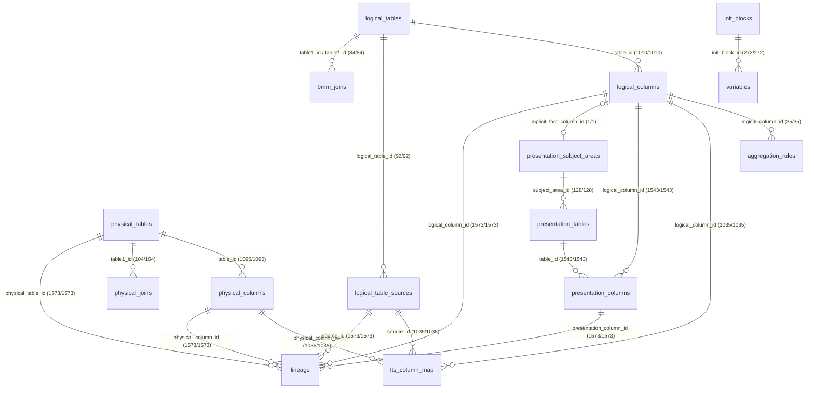

# OBIEE → Power BI Migration Assistant

A deterministic Python extractor that reads an OBIEE repository and produces the **Estate Knowledge Base** — CSV tables capturing every metric's exact logic, its full lineage to physical tables, and the metadata that silently breaks numeric parity when missed.

**No LLM participates in extraction.** Identical input produces byte-identical output.

This repository currently contains **Epic 1: extraction**. Downstream migration (Migration Spine, Group Spec, Power BI generation, parity validation) is not built yet.

---

## Requirements

**Python 3.11 or newer. That is the entire list.**

```sh
python3 --version   # must be >= 3.11
```

Nothing to install: no `pip install`, no virtualenv, no build step, no service. The extractor imports only the standard library — a hard architectural rule, and a test asserts it. If your `python3` is older, call a newer one explicitly: `python3.12 -m tools.rpd_extract.cli …`

---

## What input it needs

**MDS XML** — OBIEE's exploded repository format, one XML file per object:

```
<your-repository>/
  oracle/bi/server/base/
    PhysicalTable/<guid>.xml
    LogicalTable/<guid>.xml
    LogicalTableSource/<guid>.xml
    PresentationCatalog/<guid>.xml
    …
```

If you have a directory shaped like that, you are ready.

### Converting your `.rpd` to MDS XML

Two ways. Both produce the same thing: one XML file per repository object.

#### Option A — Administration Tool (GUI)

1. **Open the repository in offline mode.** MDS XML is only offered offline — if the repository is open online, the menu option will not appear.
2. **File → Save As → MDS XML Documents**, and choose an output directory.
3. On first opening the result, the Administration Tool asks whether it is a **standalone MDS XML repository** or **under source control**. Either answer works for this tool; it only reads files.

#### Option B — `biserverxmlgen` (command line)

Ships with the OBIEE server and with the BI Client Tools install. On the server it is typically under `$ORACLE_HOME/bi/bifoundation/server/bin` (Linux) or `%ORACLE_HOME%\bi\bifoundation\server\bin` (Windows).

```sh
biserverxmlgen -R /path/to/your.rpd -D /path/to/output-dir -M -8
```

| Flag | Meaning | Why |
|---|---|---|
| `-R` | source `.rpd` | |
| `-D` | output **directory** | one file per object — this is what makes it MDS XML |
| `-M` | MDS XML format | **required.** Without it you get a single XUDML file, which this tool does not read |
| `-8` | UTF-8 output | matches the encoding the extractor expects |
| `-P` | repository password | see the warning below |

**Both `-M` and `-D` are needed.** `-M` alone with `-O` writes one big MDS file; `-D` alone without `-M` writes plain XUDML. Only `-M -D` together give the exploded per-object layout.

> **⚠️ Do not pass `-Q`.** It generates the script *without security objects*, which silently discards the application roles, privileges and row-level filters this tool extracts for FR-4. You would get a clean-looking export missing your entire security layer — exactly the kind of silent omission the product is designed to catch. Likewise `-S` gives you *only* security objects.

> **⚠️ Credentials.** Passing `-P <password>` puts your repository password into shell history and into the process list where other users can see it. Omit `-P` and let the utility prompt, or use your platform's secret handling. This tool never sees, stores, or needs the password — it reads already-exported files.


---

## Run it on your repository

```sh
cd /path/to/POC-RPD

python3 -m tools.rpd_extract.cli \
  --corpus /path/to/your-repository \
  --rpd-id my-estate \
  --out /tmp/kb
```

```
rpd-ids:  my-estate
parsed:   21 objects
skipped:  0 objects  -> /tmp/kb/unparsed.csv
written:  /tmp/kb
```

**`--corpus`** points at the directory containing `oracle/bi/server/base/`.

**`--rpd-id`** is the name **you** choose for this repository. It becomes the permanent prefix of every identifier the tool produces — `my-estate::bmm::Sales.Fact.Revenue` — so a Group Spec or a parity check can cite a row unambiguously.

Pick it deliberately. Lower-kebab (`my-estate`, `prod-rpd`), and **stable**: changing it later invalidates every citation that used it. The tool will never invent one for you, and never derives it from a filename, a timestamp, or a hash — that is the point of it being an argument.

### Resetting the Knowledge Base

Re-running **overwrites every table**, so a normal refresh needs no cleanup — switching
from a 6000-object estate to a 20-object one leaves no residue from the first.

The one case that needs care: a table the current extractor no longer writes **survives**
a plain re-run, and a stale table in a Knowledge Base looks perfectly legitimate. So after
changing the extractor's table set, rebuild from empty:

```sh
python3 -m tools.rpd_extract.cli --corpus <yours> --rpd-id my-estate --out estate/knowledge-base --clean
```

`--clean` **refuses to run** unless the directory is empty or already contains
`manifest.csv` — proof this extractor wrote it. Without that check, pointing `--out` at
the wrong directory would delete every CSV in it. Non-CSV content is never touched, so a
`.gitignore` or a subdirectory survives.

Consumers should read the table list from `manifest.csv` rather than listing the
directory. Then a stale file is invisible to them and this question stops mattering.

### More than one repository

Put each under its own directory, named for its `rpd-id`, and drop the flag:

```
estates/
  prod-rpd/oracle/bi/server/base/…
  legacy-rpd/oracle/bi/server/base/…
```

```sh
python3 -m tools.rpd_extract.cli --corpus estates --out /tmp/kb
```

Identically-named objects from different repositories stay distinct — `prod-rpd::bmm::Sales.Revenue` and `legacy-rpd::bmm::Sales.Revenue` are two measures, not one. Merging them is a human decision the tool refuses to make for you.

---

## Try it first, without your own data

Five OBIEE constructs are committed to this repository, so you can see it work before pointing it at anything of yours:

```sh
python3 -m tools.rpd_extract.cli \
  --corpus estate/test-corpus/constructed-cases/constructed \
  --rpd-id demo \
  --out /tmp/demo

ls /tmp/demo
column -s, -t < /tmp/demo/aggregation_rules.csv | cut -c1-120
```

Expect `parsed: 21`, `skipped: 0`. Run the test suite too:

```sh
python3 -m unittest discover -s tools/rpd_extract/tests -t .   # Ran 79 tests … OK
```

There is also a larger public corpus used to develop the tool — 1383 files across two real repositories. Setup is in `estate/test-corpus/corpus.md`; you do not need it to use the extractor on your own estate.

---

## What you get

`--out` receives one CSV per concern. Row counts below are from the 1383-file development corpus, to give a sense of scale:

| Table | Rows | What it holds |
|---|---|---|
| `physical_tables` / `physical_columns` | 100 / 1096 | Source database objects |
| `physical_joins` | 104 | Foreign keys and complex joins |
| `logical_tables` / `logical_columns` | 82 / 1010 | Metric definitions, **formulas verbatim** |
| `aggregation_rules` | 35 | One row per rule; overrides never collapsed |
| `presentation_subject_areas` / `_tables` / `_columns` | 21 / 128 / 1543 | What report authors see |
| `logical_table_sources` / `lts_column_map` | 92 / 1035 | How logical maps to physical |
| `lineage` | 1573 | **presentation → logical → source → physical** |
| `bmm_joins` | 84 | Join types, inner vs outer |
| `variables` / `init_blocks` | 345 / 154 | Session and repository variables |
| `security_rls` | 198 | Roles, privileges, row-level predicates |
| `coverage` | — | Objects parsed and skipped, per type |
| `unparsed` | 336 | **Known gaps** — content not modelled, and how much of it |
| `errors` | 31 | **Things that went wrong** — kept separate on purpose |
| `manifest` | — | Source, timestamp, extractor version |

### `unparsed.csv` and `errors.csv` — read both, they answer different questions

**`errors.csv` is the one to read first.** Something that should have been captured was not: malformed XML, a reference that would not resolve, an object with no name, a directory that could not be read. Each row names the source object, the kind, and the reason. **An empty `errors.csv` is the good outcome.** The CLI exits `3` when it is non-empty, so it is scriptable.

**`unparsed.csv` is known gaps, and a healthy file is not empty.** Three kinds:

| `kind` | Meaning |
|---|---|
| `unmodelled_type` | An object type no parser has been written for. Expected |
| `unread_attribute` | An attribute present on an object we *did* parse, that no column carries |
| `unread_element` | Same, for a child element |

The last two matter more than they look. **An object can parse "successfully" while attributes and elements on it are discarded silently** — the same failure NFR7 names as primary, one level below where AD-3 was watching. On the development corpus that is **136 distinct items across 8148 occurrences**, including the SQL that defines `select`-type views.

It is also the **format-drift detector**. A repository from a different OBIEE version carrying new attributes announces itself here instead of being quietly dropped — which is the honest answer to "will this work on my estate?"

---


## How the tables connect

Every foreign key below was verified against the real corpus — the counts in
brackets are how many rows resolved out of how many were present.



### Reading it

**`lineage` is a materialised join, not an entity.** It is the only table touching all
four layers at once, and it exists so "where does this number come from" is one lookup
instead of a five-way join you have to get right yourself. Every other table is an
entity plus its own foreign keys.

**The three layers stack downward**, and each is reachable from the one above:

```
presentation_subject_areas → presentation_tables → presentation_columns
                                                          │ logical_column_id
                                                          ▼
                                   logical_tables → logical_columns → aggregation_rules
                                          │                  │
                                          ▼                  │
                            logical_table_sources ───────────┤
                                          │  lts_column_map  │
                                          ▼                  ▼
                                   physical_tables → physical_columns
```

**Two relationships are deliberately partial, and the diagram would lie if it hid them:**

- **`physical_joins.table2_id` resolves 4 of 104.** Foreign-key joins name one table and
  a column list; only complex joins name two tables. An empty `table2_id` is a foreign
  key, not a broken reference.
- **`security_rls.subject_id` resolves 6 of 196.** It is polymorphic by nature: `row_filter`
  rows point at a logical table, while `object_privilege` and `query_privilege` rows point
  at privileges. Read `kind` before joining on it.

**Four tables carry no keys at all** — `manifest`, `coverage`, `unparsed`, `errors`. They
describe the extraction run rather than the estate, and they are joined by nothing because
nothing should depend on them being present.

**Everything joins on `row_id`**, which is qualified by `rpd-id` (AD-7). Two repositories in
one Knowledge Base never collide: `prod-rpd::bmm::Sales.Revenue` and
`legacy-rpd::bmm::Sales.Revenue` are two rows, and no join will merge them.

## Read a metric end to end

The thing the product exists to do — four lookups, no OBIEE client:

**`presentation_columns.csv`** — start from the name a report author sees:
```
row_id            demo::pres::Sales SA.Facts.Total Revenue
logical_column_id demo::bmm::Sales BM.Fact Sales.Revenue
```

**`logical_columns.csv`** — what it actually is:
```
name Revenue   is_measure true   mapped_source_count 1 / 2
```

**`aggregation_rules.csv`** — how it aggregates, verbatim:
```
is_default      true
expr_text       ' SUM("%1")'
expr_text_desc  ' SUM("Sales BM"."Fact Sales"."Revenue")'
```

**`lineage.csv`** — where the number comes from:
```
-> LTS_DETAIL -> demo::phys::SCHEMA.FCT_SALES.AMOUNT
```

### Two columns worth understanding

**`mapped_source_count` vs `source_count`.** The first counts sources that actually map *this column*; the second counts sources on its *table*. When they differ, some source cannot supply that column — so a query needing it cannot use that source. That gap is a real parity hazard and it is why both are recorded.

**Every expression appears three times.** OBIEE stores each one three ways, and all three are kept:

| Column | Example | What it is |
|---|---|---|
| `expr_text` | `SUM("%1")` | the template, with placeholders |
| `expr_text_desc` | `SUM("Sales"."Fact"."Revenue")` | rendered — **derived, not authoritative** |
| `expr_refs` | `my-estate::phys::…AMOUNT` | what the placeholders bind to |

Keeping one and discarding the others would rewrite the formula. Note the **leading space** in `' SUM("%1")'` — that is in your source, and preserving it exactly is the point.

### Opening the CSVs in a spreadsheet

They are built to survive it. Values a spreadsheet would corrupt — a formula starting `-`, an identifier like `00123` — are guarded, and a companion `<column>_guarded` column records which. Details: `documents/planning-artifacts/decisions/csv-formula-guard.md`.


## Accuracy report

Checks each parity-critical construct and reports **per construct type, never as one aggregate number**:

```sh
python3 -m tools.rpd_extract.verify \
  --corpus /path/to/your-repository \
  --rpd-id my-estate \
  --cases estate/test-corpus/constructed-cases \
  --out /tmp/accuracy.csv
```

Read the `evidence` column: `corpus` means your real content proves it; `constructed` means a hand-authored test case does. They are never merged — hand-authored evidence is weaker, and combining them would overstate the result.

**`unimplemented` is not a failure.** It means nothing in the input exercises that construct, so the tool refuses to claim it works. Running against your estate will likely shift which constructs land there — that is the report doing its job.

---

## What this does **not** do yet

- **No Web Catalog.** No Dashboards or Analyses — the report layer parser is not built.
- **No parity checking.** No migrated number has been compared to a legacy one. This is the product's central claim and it is **unproven**.
- **No Power BI output.** No Group Spec, no Migration Spine, no PBIP/TMDL.
- **Only MDS XML input**, as above.

---

## Troubleshooting

| Symptom | Cause |
|---|---|
| `no MDS XML found under …` | `--corpus` is not pointing at a directory containing `oracle/bi/server/base/`. With `--rpd-id`, point at the repository root; without it, at a directory of repository folders |
| `… looks like the 'base' directory itself` | You aimed `--corpus` too deep. The error names the directory to use instead |
| `--rpd-id was given, so … must itself contain oracle/bi/server/base/` | You passed `--rpd-id` but aimed at a parent of several repositories. Drop the flag |
| `rpd-id 'My_Estate' is not lower-kebab` | Use `my-estate`. It becomes an identifier prefix, so it has to be stable and readable |
| `ModuleNotFoundError: No module named 'tools'` | Run from the repository root — `python3 -m tools.rpd_extract.cli` |
| Lots of rows in `unparsed.csv` | Expected. Check `kind` — `unmodelled_type` is a missing parser, `unread_*` is source content no column carries |
| Any rows in `errors.csv` | Something was lost. Check `kind` and `reason`. The CLI exits `3` when this file is non-empty |
| Spreadsheet mangled a formula | Check the `<column>_guarded` flag. If `true` and it still mangled, that is a real defect worth reporting |

---

## Where things live

```
tools/rpd_extract/
  core/          Estate model and identifiers — no I/O, no file-format concepts
  adapters/
    inbound/     mds_xml.py — the only place OBIEE's format is understood
    outbound/    csv_writer.py, knowledge_base.py
  tests/         stdlib unittest + fixtures with recorded Ground Truth
  cli.py         extraction entry point
  verify.py      per-construct accuracy report

estate/test-corpus/   corpus docs, benchmark set, Constructed Cases
documents/            PRD, Architecture Spine, decisions, stories
```

`estate/test-corpus/mds-xml-schema.md` documents the input format, derived by parsing 1383 real files — Oracle publishes no schema for it, so it is the only specification that exists.

**Note on output:** `estate/knowledge-base/` is gitignored here, because our development corpus is unlicensed and contains personal names. Your own output is yours — decide separately whether it belongs in version control.
