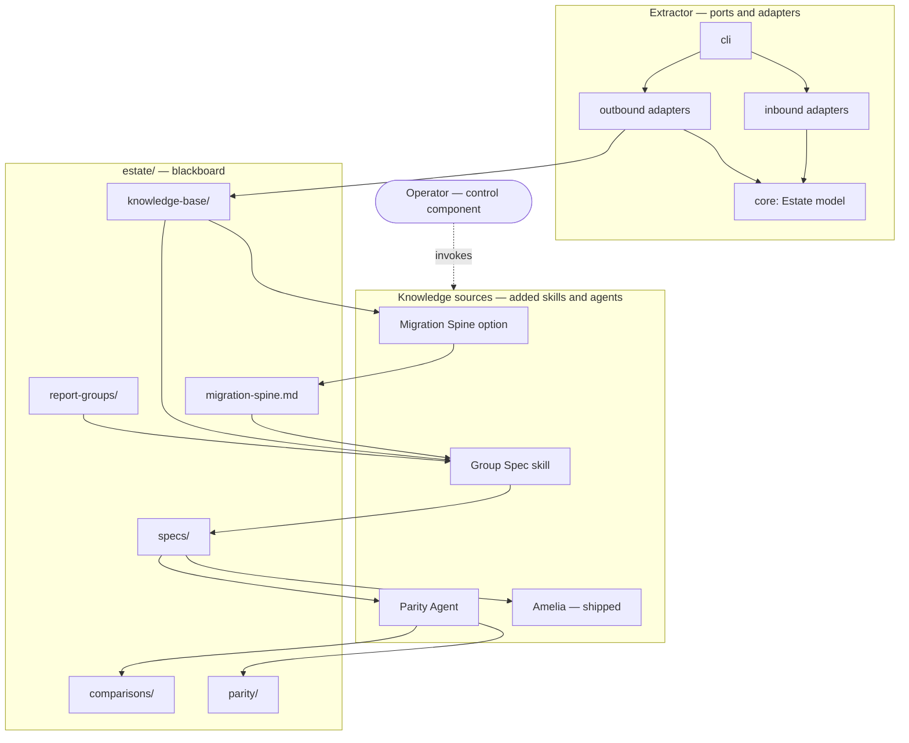
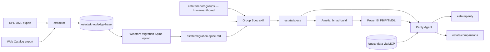

# Architecture Spine — OBIEE → Power BI Migration Assistant

## Design Paradigm

Two paradigms, with a stated boundary between them. The system is not one program; it is a program plus a set of human-invoked skills, and forcing one paradigm across both hides the difference that matters.

**The extractor is ports and adapters.** A pure core holding the Estate model and the parsing rules, surrounded by adapters for every format it touches. Every unconfirmed assumption in the PRD — RPD export format, catalog export mechanism, Power BI target format, data access transport — is an edge, so the edges are where the isolation goes.

| Layer | Lives in | Depends on |
| --- | --- | --- |
| Core | `tools/rpd_extract/core/` | nothing; performs no I/O |
| Inbound adapters | `tools/rpd_extract/adapters/inbound/` | core |
| Outbound adapters | `tools/rpd_extract/adapters/outbound/` | core |
| CLI | `tools/rpd_extract/cli.py` | core, adapters |

**Everything downstream is a blackboard.** `estate/` plus the repository is the shared knowledge store; each added skill is a knowledge source that reads it, contributes, and writes back; the human Operator is the control component deciding which knowledge source runs next. There is no orchestrator and no automated control flow. Every invariant in the next section that concerns skills exists because the control component is a person who will run things out of order.

## Invariants & Rules



### AD-1 — Two paradigms, one boundary

- **Binds:** all
- **Prevents:** applying blackboard looseness inside the extractor, or expecting pipeline determinism from human-invoked skills.
- **Rule:** the extractor is ports and adapters and is the only automated program. Everything above it is a blackboard with a human control component. No component may span the boundary; the extractor writes to the blackboard and never reads it back.

### AD-2 — The extractor is the sole writer to the Knowledge Base

- **Binds:** FR-1..FR-9, all skills
- **Prevents:** LLM-produced content entering the store that Group Specs and Parity Checks cite as source truth.
- **Rule:** only the extractor writes `estate/knowledge-base/`. Any content there originating from an LLM is a defect. Skills read it and write their output elsewhere.

### AD-3 — Python never guesses

- **Binds:** FR-1..FR-5
- **Prevents:** an approximated parse becoming indistinguishable from a certain one, which is the silent-wrong-number failure mode.
- **Rule:** where the extractor cannot parse with certainty it records an unparsed entry carrying the source identifier and the reason, and continues. It never approximates and never delegates to an LLM. An agent may propose an interpretation, but the proposal lands in a Group Spec for human review, never back in the Knowledge Base. The unparsed list is the handoff point between deterministic and judgement.

### AD-4 — No skill assumes another skill has run

- **Binds:** all added skills
- **Prevents:** breakage when the Operator invokes skills out of order, which the operating model guarantees will happen.
- **Rule:** every skill determines the current state by reading the blackboard. It states missing prerequisites and stops; it never assumes a predecessor completed, and it never encodes an expected sequence.

### AD-5 — Every artifact is self-describing

- **Binds:** all blackboard artifacts
- **Prevents:** a skill or a human acting on an artifact without knowing what it was derived from or when.
- **Rule:** each artifact records what produced it, what it was derived from (by identifier), and when. The Knowledge Base carries a manifest naming its tables, the source RPDs, the extraction timestamp, and the extractor version.

### AD-6 — Every operation is idempotent

- **Binds:** extractor, all added skills
- **Prevents:** re-running being unsafe, when re-running is the operating model rather than misuse.
- **Rule:** re-running any operation over unchanged input produces byte-identical output and disturbs nothing else. Extraction of one RPD never alters Knowledge Base content belonging to another.

### AD-7 — Identifiers are RPD-qualified

- **Binds:** FR-8, FR-12, FR-17..FR-19
- **Prevents:** two repositories' identically-named objects collapsing into one, silently repointing a Spec or a Parity Check at the wrong definition.
- **Rule:** every Knowledge Base identifier is qualified by its source RPD from the first extraction, while only one RPD exists. The `rpd-id` qualifier is **declared by the Operator at extraction and recorded in the manifest** — never derived from the export filename, the export timestamp, or a content hash, since all three change without the repository changing. Re-extraction under a different declared `rpd-id` is a new source, not a regeneration. All citations — Specs, Parity Checks, Comparison Reports — use the qualified form.

### AD-8 — Name equality across RPDs is not semantic equality

- **Binds:** FR-12, FR-13, Report Group declarations
- **Prevents:** two different business measures merging under one name — silent, propagating, and unrecoverable once reports are built on it.
- **Rule:** identically-named objects from different RPDs are distinct by default and both survive, qualified. Sameness is declared by a human, never inferred. A declared sameness is a testable claim and is verified by a parity check between the two legacy definitions before it is relied on.

### AD-9 — Report Group is declared, never inferred

- **Binds:** FR-7, FR-12, FR-13
- **Prevents:** the tool inventing a grouping that no one owns, in a migration that is otherwise as-is.
- **Rule:** a Report Group is a human-authored artifact under `estate/report-groups/` mapping N `(RPD, Subject Area)` pairs to one target Semantic Model. Skills read it. No skill derives grouping from the Presentation Layer.

### AD-10 — Merge the container, never the definitions

- **Binds:** FR-12, FR-16
- **Prevents:** the cross-RPD grouping decision leaking into measure logic and breaking the as-is guarantee.
- **Rule:** a Semantic Model may hold measures sourced from several RPDs. Each measure retains its verbatim OBIEE logic, its own lineage, and its RPD qualification. The container is new; every measure in it is as-is. The Report Group declaration is the only place a design decision enters.

### AD-11 — Skills bind to a capability floor, not a client

- **Binds:** FR-25, all added skills
- **Prevents:** one product on the development machine and a degraded one in the VDI.
- **Rule:** the floor is exactly: read a file, write a file, run a local command. No added skill may assume anything above it — MCP availability, parallel execution, web access, or client-specific tool names.

### AD-12 — No skill requires subagent delegation

- **Binds:** all added skills
- **Prevents:** a skill that works where delegation is available and fails where it is not.
- **Rule:** every added skill completes its work without delegating to subagents. Delegation may be an optimisation; it is never load-bearing. A skill whose task cannot fit one context window must partition its input — which is why the Knowledge Base is selectively-readable tables rather than one document.

### AD-13 — Naming firewall

- **Binds:** all artifacts, skills, code, documentation
- **Prevents:** the tool's output and this document collapsing into one ambiguous word once several people are writing skills.
- **Rule:** the bare word *Spine* is never used. **Migration Spine** is the product's output — the OBIEE-to-Power-BI construct mapping for the estate. **Architecture Spine** is this document, governing the tool.

### AD-14 — Shipped BMad is read-only

- **Binds:** FR-11, FR-23..FR-25
- **Prevents:** a BMad upgrade silently removing added capability, and the adaptation premise degrading into a fork.
- **Rule:** nothing under `_bmad/` or the shipped skill directories is edited. Additions are new skill directories plus `_bmad/custom/<skill>.toml` overrides, whose menu arrays key by `code` so new entries append.

### AD-15 — Dependency direction

- **Binds:** all
- **Prevents:** cycles, and skills coupling to extractor internals rather than to artifacts.
- **Rule:** core depends on nothing and performs no I/O; adapters depend on core and never the reverse; skills depend only on blackboard artifacts, never on extractor code; no skill depends on another skill; nothing depends on a specific AI client.

### AD-16 — Deployment is a file copy

- **Binds:** FR-23..FR-25
- **Prevents:** an installation procedure accumulating until porting becomes a project.
- **Rule:** there is no build, no packaging step, no service, and no installer. Delivery to the VDI is copying the repository. Any change that introduces an installation step is a breach of this rule, not an implementation detail.

### AD-17 — One Report Group owns a Subject Area

- **Binds:** FR-7, FR-12, FR-13, Report Group declarations
- **Prevents:** the same Subject Area appearing in two Report Groups, producing two Semantic Models that each define its measures independently — metric drift arriving through the grouping layer rather than the naming layer.
- **Rule:** a `(RPD, Subject Area)` pair belongs to at most one Report Group. A second claim is an error surfaced when the declarations are read, never a silently created second model.

### AD-18 — Every blackboard area has exactly one writer

- **Binds:** all blackboard artifacts, all skills
- **Prevents:** two producers contributing to one area with different assumptions, and a regenerating producer destroying content it did not create.
- **Rule:** each `estate/` area has one declared writer, listed in the layout below. No component writes outside the area it owns. Where a human contributes evidence to an area an agent regenerates, that evidence lives in a subdirectory the agent never writes.

### AD-20 — The serialisation is MDS XML, and it is one adapter, not an abstraction

- **Binds:** FR-1..FR-5, AD-1, AD-15
- **Prevents:** a format-agnostic parsing layer built for a second format nobody has seen, and equally, an MDS-shaped assumption leaking out of the adapter into the core.
- **Rule:** the inbound adapter is `mds_xml` and targets OBIEE **MDS XML** — an exploded tree of one XML file per object under `oracle/bi/server/base/<ObjectType>/<guid>.xml`, namespace `http://www.oracle.com/obis/repository`, cross-referenced by `<path>.xml#<mdsid>`. The single-file `biserverxmlgen` export assumed by PRD §4.1 is **not** targeted, because producing it requires an OBIEE instance the project has established it cannot obtain. No format-neutral abstraction is built over the two: Rule of Three, and we have one. The core's Estate model must contain no MDS-specific concept — GUIDs, file paths, and `#mdsid` fragments terminate at the adapter, which is what makes a future `rpd_xml` adapter an addition rather than a rewrite.

**Note:** this suits AD-12. One file per object means input partitions naturally by object type, so no skill or extraction pass must hold a whole repository in memory.

### AD-21 — Every representation the source provides is captured

- **Binds:** FR-2, FR-3, FR-4, FR-6, AD-3
- **Prevents:** the lossy choice that silently voids the verbatim guarantee the product's central claim rests on.
- **Rule:** where a source records an expression in more than one representation, **every representation is captured verbatim, each in its own field.** Selecting one and discarding the others is a rewrite of the formula and therefore a breach of FR-2, and choosing between them is precisely the guess AD-3 forbids. Where a source records exactly one representation, capture it — there is no choice to make and nothing is lost.

**By format.** MDS XML stores three at once: `ExprText` (a template carrying `%1` placeholders), `ExprTextDesc` (that template rendered with object names resolved), and `ObjectRefList` (the references the placeholders bind to). `ExprTextDesc` is a *derived rendering* and is never authoritative — it is what a reviewer reads; `ExprText` with `ObjectRefList` is what a Parity Check reasons over. Web Catalog XML stores **one**: `sawx:expr` inside `saw:columnFormula` — verified across 409 expressions, with no `ExprText`, `ExprTextDesc` or `ObjectRefList` present.

*Restated 2026-08-17. The rule previously counted to three, which was MDS-specific and unsatisfiable for a single-form source. Stating the principle rather than the count keeps it true across formats, and removes the incentive for a third format to argue for its own exception.*

**Where expressions occur** (measured across the corpus, not assumed): `LogicalColumn/Expr` (derived columns — FR-2's primary target), `AggrRule/Expr` (FR-4), `AttrDefn/Expr`, `ColumnMapping/{LogicalColumnExpr,Expr}` (FR-3 lineage), `LogicalTableSource/WhereClause` (FR-4 content filters), `LogicalTableSource/GroupBy`, `Variable/Expr`, and `ComplexJoin/Expr`. An expression container not in this list is unparsed per AD-3, never skipped.

### AD-22 — The Web Catalog is a separate store, paired by declaration

- **Binds:** FR-6, FR-7, AD-7, AD-8
- **Prevents:** a catalog and a repository being joined because their Subject Area names happen to match — the same silent, propagating error AD-8 exists to stop, arriving across stores instead of across repositories.
- **Rule:** the Web Catalog is read by its own inbound adapter into the same Knowledge Base, under identifier layer **`cat`**. A catalog declares its own `rpd-id` at extraction like any other source. **Pairing a catalog to a repository is a human declaration, never inferred** — matching Subject Area names is not evidence, and an unpaired catalog is a legitimate state that must stay visible rather than being resolved by guesswork.

**On the qualifier's name.** `rpd-id` is retained for catalog objects even though a catalog is not an RPD. Renaming it to `estate-id` would invalidate every identifier already generated and every citation that uses one, to correct a word. For a catalog object, read it as *the estate this catalog belongs to*.

### AD-23 — Report lineage is a companion table, never an extension

- **Binds:** FR-3, FR-7, AD-6
- **Prevents:** a verified claim and an unverified one sharing a table, where a reader cannot tell which is which.
- **Rule:** catalog-to-semantic-layer resolution lands in `report_lineage.csv` — analysis column to presentation column — joining `lineage.csv` on `presentation_column_id`. **`lineage.csv` is never extended upward.**

Three reasons, the third decisive. Extending would change the shape of every existing lineage row to hold data that may not exist. In the unpaired case an extension yields empty columns, which reads as *no data*, whereas a companion table that does not join reads as *not paired* — which is the truth. And `lineage.csv` is RPD-internal and **verified** (1573 of 1573 references resolve), while FR-7 resolution is cross-store and, absent a matched fixture, **unverifiable**; merging them makes the table's reliability unreadable.

### AD-24 — An added skill exists in every client's discovery location

- **Binds:** FR-24, FR-25, AD-11, AD-16
- **Prevents:** a skill that works in one AI client and is invisible in the other — which is FR-25's requirement failing silently, discovered in the VDI rather than here.
- **Rule:** every added skill is present, byte-identical, in **both** `.claude/skills/` and `.agents/skills/`. Skills are written client-neutrally — paths resolve through `{skill-root}` and `{project-root}`, never through a hard-coded client directory. A skill present in only one location is a defect, and **a test asserts parity** rather than the rule depending on someone remembering.

**Why duplication rather than a symlink.** The VDI may be Windows — Power BI Desktop and the Administration Tool both are — and symlinks survive a cross-platform copy unreliably. AD-16 makes deployment a plain file copy, so the layout must survive `cp -r`, a zip, and a Git checkout on any platform. Two real copies do; a symlink may not.

**This is how BMad itself ships.** Its own skills exist as identical copies in both directories, with `.github/agents/*.agent.md` pointing Copilot at `.agents/skills/`. Added skills follow the shipped pattern rather than inventing one.

**Menu overrides need no duplication.** Both copies of an agent's `SKILL.md` resolve the same `_bmad/custom/<skill-name>.toml`, so one override file serves every client (AD-14).

### AD-19 — The extractor core is tested against Ground Truth

- **Binds:** FR-1..FR-5, FR-30, FR-31
- **Prevents:** two builders answering "how do we know the extractor is right?" incompatibly, in a product whose entire thesis is verification.
- **Rule:** the core performs no I/O precisely so it can be tested directly. Every parity-critical construct in FR-4 has a fixture with recorded Ground Truth drawn from the Test Corpus, and a construct without a fixture is treated as unimplemented. Adapters are tested against captured sample exports, never against a live OBIEE instance.

## Consistency Conventions

| Concern | Convention |
| --- | --- |
| Naming — Knowledge Base identifiers | `<rpd-id>::<layer>::<object-path>`. Lower-kebab for `rpd-id`. Never bare. Layers: `phys`, `bmm`, `pres`, `sec`, `var`, and **`cat`** for Web Catalog objects (AD-22). |
| Naming — artifacts | `estate/<area>/<subject>.<md\|csv>`; Report Groups and Specs named for the Report Group, not for a Dashboard. |
| Naming — the two spines | Per AD-13. Never the bare word. |
| Data — CSV | UTF-8, comma delimiter, LF endings, one header row, **every field quoted**, and any value beginning `=` `+` `-` `@` written so a spreadsheet cannot interpret it as a formula. |
| Data — verbatim logic | OBIEE formula text is stored character-for-character. No normalisation, reformatting, or whitespace collapsing anywhere in the chain. |
| Data — markdown | GitHub-flavoured. Formulas and DAX in fenced code blocks so nothing reflows them. |
| Data — timestamps | ISO 8601 UTC. |
| State — mutation | Artifacts are rewritten whole, never patched in place, by the area's single writer (AD-18). Human-supplied evidence — Comparison Report screenshots — lives under `estate/comparisons/evidence/`, which no agent writes. |
| State — unparsed and gaps | Always recorded, never omitted. Silent omission is the failure mode this system is designed against. |
| Errors | Fail loudly with the source identifier and the reason. Never produce a partial artifact that looks complete. |
| Config | Plain TOML or CLI arguments. No credentials in any artifact, ever. |

## Stack

| Name | Version |
| --- | --- |
| Python | `>=3.11`, no upper pin — floor only, since the runtime cannot be installed without admin |
| Python third-party packages | none, at any version |
| BMad | `>=6.11.0` — a floor, not a pin; AD-14 exists so upgrades are safe |
| Output formats | Markdown (GitHub-flavoured), CSV |

Git is required to host the repository but is not a product dependency — the tool performs no Git operations of its own (AD-16), so no version is imposed.

## Structural Seed



```text
POC-RPD/
  _bmad/                       # shipped BMad — read-only (AD-14)
    custom/                    # our overrides only
  tools/
    rpd_extract/               # the extractor (AD-1) — a self-contained copyable unit (AD-16)
      core/                    # Estate model, parsing rules — no I/O, no MDS concepts (AD-20)
      adapters/inbound/        # mds_xml (AD-20), catalog_xml
      adapters/outbound/       # csv_writer, manifest
      tests/                   # stdlib unittest; lives inside the unit that ships (AD-16, AD-19)
      cli.py
  estate/                      # the blackboard — one writer per area (AD-18)
    knowledge-base/            # writer: extractor (AD-2). CSV + manifest
    test-corpus/               # writer: Operator. Corpus manifest, docs, Ground Truth fixtures
    analysis/                  # writer: obiee-as-is-analysis skill. As-is document + CSV slice
    report-groups/             # writer: Operator (AD-9, AD-17)
    migration-spine.md         # writer: Winston's Migration Spine option (AD-13)
    specs/                     # writer: Group Spec skill
    models/                    # writer: Amelia. Generated PBIP/TMDL
    parity/                    # writer: Parity Agent. Results as CSV
    comparisons/               # writer: Parity Agent. Generated reports
      evidence/                # writer: Operator only. Screenshots — never regenerated
  documents/                   # planning artifacts — not blackboard state
```

**Environments.** Two, and they must stay identical in everything that matters: a development machine with network access, and the isolated VDI. There is no server, no shared infrastructure, no CI in Phase 0, and no provider. The only environmental difference permitted is network reachability; anything else is a breach of AD-16. Live data reaches the Parity Agent through MCP under the Operator's own access rights — no service account, no new access path.

## Capability → Architecture Map

| Capability / Area | Lives in | Governed by |
| --- | --- | --- |
| RPD extraction (FR-1..FR-5) | `tools/rpd_extract/` core + `mds_xml` inbound adapter | AD-1, AD-3, AD-15, AD-20, AD-21 |
| Catalog extraction (FR-6, FR-7) | `tools/rpd_extract/` `catalog_xml` inbound adapter → `cat` layer, `report_lineage.csv` | AD-1, AD-3, AD-9, AD-21, AD-22, AD-23. **FR-6 has a fixture; FR-7 has no matched pair** |
| Knowledge Base (FR-8, FR-9) | `estate/knowledge-base/` | AD-2, AD-5, AD-6, AD-7 |
| Migration Spine (FR-10, FR-11) | `_bmad/custom/bmad-agent-architect.toml` + new skill | AD-13, AD-14 |
| As-is analysis (FR-12 partial) | `obiee-as-is-analysis` skill + `_bmad/custom/bmad-agent-architect.toml` → `estate/analysis/` | AD-2, AD-4, AD-11, AD-12, AD-14, AD-18 |
| Group Spec (FR-12..FR-15) | new skill → `estate/specs/` | AD-4, AD-8, AD-9, AD-10, AD-12, AD-17, AD-18 |
| Power BI generation (FR-16) | Amelia via `bmad-build` → `estate/models/` | AD-14, AD-15, AD-18 |
| Parity validation (FR-17..FR-20) | Parity Agent → `estate/parity/` | AD-4, AD-7, AD-11, AD-18 |
| Data connectivity (FR-21, FR-22) | MCP configuration | AD-11, AD-16 |
| Packaging and portability (FR-23..FR-25) | repository layout | AD-11, AD-12, AD-14, AD-16 |
| Artifact formats (FR-26..FR-29) | conventions above | AD-5, conventions |
| Test Corpus (FR-30, FR-31) | `estate/` fixtures + SampleApp | AD-6, AD-19 |
| Comparison Report (FR-32..FR-34) | Parity Agent → `estate/comparisons/`; evidence by Operator | AD-5, AD-18 |

## Deferred

- **Stale-Spec detection after re-extraction.** An RPD is not expected to change during the development period, so re-extraction of an unchanged source is a rare manual event. Revisit when the first RPD changes in place, or before any second migration wave.
- **Catalog adapter internals.** The Web Catalog export mechanism is unconfirmed; the adapter boundary is fixed by AD-1, its interior is not. Decide when the export format is known. **Now sharper:** the available corpus contains no Web Catalog at all, so FR-6 and FR-7 have no fixture. The adapter cannot be written, let alone tested, until real catalog content exists.
- **A `biserverxmlgen` inbound adapter.** Not built (AD-20). Becomes real work the moment an estate can only export single-file XML. AD-20's requirement that the core hold no MDS-specific concept is what keeps that an addition rather than a rewrite — treat any leak of GUIDs or `#mdsid` fragments into the core as a defect against this deferral, not a shortcut.
- **The corpus itself lives outside the repository.** `estate/test-corpus/` holds only artifacts we author — the corpus manifest, documentation, and Ground Truth fixtures. Source XML is not committed: it is unlicensed, it carries personal data, and AD-16 means every committed byte ships to the VDI. The extractor reaches the corpus by path argument, exactly as it will reach a real estate.
- **PBIP/TMDL generation approach.** Owned by Phase 2 and by Amelia, who is used unmodified. Any migration-specific guidance belongs in the Migration Spine, not in a changed Dev agent.
- **MCP transport and server selection.** Gated on confirming a no-admin installation path in the VDI. AD-11 already prevents skills depending on it.
- **Concurrency.** A single Operator working one Dashboard at a time. No locking, no merge strategy on the blackboard beyond Git. Revisit on **any second concurrent line of work on the same Estate — a second Operator or a second branch**; the branch case arrives sooner, and Git's merge behaviour on CSV differs from markdown.
- **Logging and observability.** Loud failure and the unparsed list cover Phase 0. Revisit if the coverage report proves insufficient for diagnosing extraction problems.
- **CI.** No pipeline in Phase 0; correctness is established by the Test Corpus run by hand. Revisit at Phase 1.
- **Cross-RPD reconciliation depth.** AD-8 fixes the default and the declaration mechanism. Whether declarations can cover a whole namespace rather than measure-by-measure depends on why the estate has multiple RPDs, which is not yet known.
