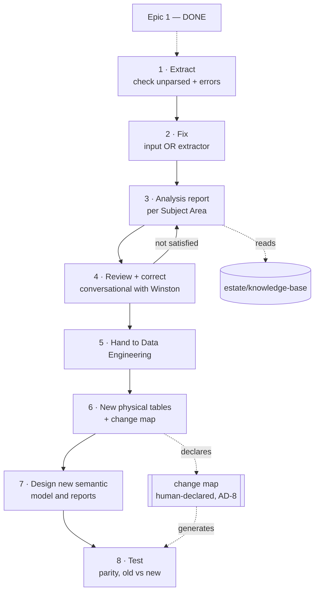

---
stepsCompleted:
  - step-01-validate-prerequisites
  - step-02-design-epics
  - step-03-create-stories
  - step-04-final-validation
inputDocuments:
  - documents/planning-artifacts/prds/prd-POC-RPD-2026-08-15/prd.md
  - documents/planning-artifacts/architecture/architecture-POC-RPD-2026-08-15/ARCHITECTURE-SPINE.md
---

# POC-RPD - Epic Breakdown

## Overview

This document provides the complete epic and story breakdown for POC-RPD (OBIEE → Power BI Migration Assistant), decomposing the requirements from the PRD and the Architecture Spine into implementable stories.

**Planning stance:** Epic 1 covers environment setup and deterministic RPD extraction, and is fully decomposed here. Epic 2 onward is deliberately deferred — it will be planned once Epic 1 is complete and the extractor has taught us what the estate actually contains.

## Requirements Inventory

### Functional Requirements

**Estate Extraction — RPD (§4.1)**

FR-1: Parse RPD source — point the extractor at an RPD XML export and receive a parsed representation of all three layers (Physical, BMM, Presentation); unrecognised root element fails with a clear error naming the expected format rather than producing a partial Knowledge Base.
FR-2: Capture exact metric logic — each logical column's formula stored verbatim, character-for-character; never rewritten, simplified, or reformatted.
FR-3: Capture full lineage — every presentation column traceable presentation name → logical column → LTS → physical table.column; columns with multiple LTSs list all of them.
FR-4: Capture parity-critical metadata — aggregation rule per logical column including dimension-specific overrides; LTS priority order and fragmentation predicates; content-level filters per LTS; BMM join type (inner vs left outer); time-series function usage (AGO, TODATE, PERIODROLLING) flagged per column; session and repository variables referenced in filters or formulas; the full physical → logical → presentation rename chain; implicit fact column per Subject Area; row-level security filters per application role.
FR-5: Report extraction coverage — output includes a coverage summary of objects parsed, objects skipped, and the reason for each skip; every unrecognised construct appears in the skipped list with its source identifier.

**Estate Extraction — Web Catalog (§4.2)**

FR-6: Parse Web Catalog structure — Dashboards with tabs and placed Analyses; Analyses with selected columns, filters, view types; Dashboard prompts and their bound columns.
FR-7: Resolve catalog to semantic layer — each Analysis column resolved to a named presentation column or listed as unresolved with a reason; each Dashboard assigned to exactly one Report Group; multi-Subject-Area Dashboards flagged for Operator decision.

**Estate Knowledge Base (§4.3)**

FR-8: Produce the Knowledge Base — a directory of CSV tables separated by concern (physical objects, logical objects and formulas, lineage, presentation columns, security, dashboards, analyses, coverage summary); each opens correctly in a spreadsheet; every row carries a stable identifier citable from a Group Spec; regeneration from unchanged source is byte-identical; a manifest lists tables present, extraction source, and extraction timestamp.
FR-9: Estate-wide scope enforcement — the Knowledge Base covers the entire Estate; the extractor accepts no per-Dashboard scoping argument; every Dashboard migration reads from the same single Knowledge Base.

**Migration Spine (§4.4)**

FR-10: Author the Migration Spine — Winston produces a Migration Spine from the Knowledge Base covering, at minimum, aggregation rule semantics, time-series functions to DAX time-intelligence patterns, LTS fragmentation handling, BMM join type handling, RLS role mapping, and naming conventions; any construct in the Knowledge Base with no defined mapping is listed explicitly as an open decision.
FR-11: Extend the Architect without forking — capability added by configuration override; no file under `.claude/skills/bmad-agent-architect/` modified; the new menu entry appears alongside shipped entries and survives a BMad upgrade.

**Group Spec Generation (§4.5)**

FR-12: Generate a Group Spec — states the target Semantic Model's tables, relationships, measures, hierarchies, and RLS roles; every measure carries its source OBIEE logic verbatim alongside proposed DAX; every table carries lineage to physical source tables; report definitions for the group's Dashboards; references Knowledge Base row identifiers throughout.
FR-13: Additive specification against existing models — reused objects listed separately from new objects; a Spec requiring no new model objects says so explicitly; never proposes creating an object whose equivalent already exists.
FR-14: Flag judgement points — unmapped constructs raised as Operator decisions, never silently resolved; ambiguous multi-LTS precedence raised for confirmation; a confidence indication recorded per measure with low-confidence measures listed together.
FR-15: Consumable by the existing BMad chain — one Dashboard corresponds to one story; the Spec's structure verified against `bmad-create-epics-and-stories` by a spike, with any needed adapter scoped as work rather than assumed away.

**Power BI Generation (§4.6)**

FR-16: Generate Power BI project files — PBIP/TMDL that opens in Power BI Desktop without repair; generated measures correspond one-to-one with Group Spec measures; output is text and diffable; generation adds to an existing Semantic Model where the Spec says reuse.

**Parity Validation (§4.7)**

FR-17: Author Parity Checks from a Group Spec — at least one check per measure; unfiltered totals and at least one filtered slice per measure; the dimension combinations the source Dashboard actually displays.
FR-18: Execute Parity Checks against live data — legacy result from OBIEE or its warehouse; migrated result from the generated Power BI model; configurable numeric tolerance recorded with the result; a check that cannot execute is reported as errored, never as passed.
FR-19: Report divergence as a triage list — checks passed, failed, and errored; each failure names measure, filter context, expected value, actual value, and difference; failures grouped by probable cause where the Knowledge Base supports the inference.
FR-20: Parity gate before completion — story completion requires a recorded Parity Check run with zero failures, or an explicit recorded Operator override with a reason; overrides logged and visible in the migration record.

**Data Connectivity (§4.8)**

FR-21: Query legacy data via MCP — connection configuration external to agent definitions with no embedded credentials; operates under the Operator's own access rights; a forbidden query fails with a permission error and is reported as errored.
FR-22: Query the migrated model — queries execute against the model as generated, without manual publication steps during Phase 2 validation.

**Packaging and Portability (§4.9)**

FR-23: No-admin installation — installs as an unprivileged user via `pip --user`, a virtual environment, or vendored wheels; no dependency requires a compiled extension, system package, or service; installation succeeds with no internet access from a pre-staged bundle.
FR-24: Markdown and configuration only — every added agent and skill definition is markdown or TOML; no added component requires a runtime beyond Python and the AI client already present; copying the Migration Module directory into a comparable environment yields a working installation.
FR-25: Runtime portability — added skills function under Claude Code and under the VDI's Copilot client; no added component depends on a capability present in only one client.

**Artifact Formats (§4.10)**

FR-26: Deliver Narrative Artifacts as markdown — renders correctly on GitHub including tables and nested lists; OBIEE formulas and DAX in fenced code blocks; each artifact a single file at a stable path; no conversion step before a human can read it.
FR-27: Deliver Tabular Artifacts as CSV — single header row, one record per line; UTF-8 with documented delimiter and consistent line endings; opens in a spreadsheet with columns correctly separated and no manual import configuration; related tables share stable identifiers so they can be joined.
FR-28: Spreadsheet-safe CSV integrity — all fields quoted so embedded commas, quotes, and newlines round-trip intact; any field beginning `=`, `+`, `-`, or `@` written so a spreadsheet cannot interpret it as a formula; identifier-like values do not lose leading zeros or convert to scientific notation; a write → open → save → re-read round-trip over real OBIEE formula text produces the original values.
FR-29: Narrative Artifacts meet the readability standard — each document opens with what it covers and who it is for; navigable by headings; reference material in tables rather than prose; no information restated in two places.

**Test Corpus (§4.11)**

FR-30: Establish the Test Corpus — three difficulty tiers (Simple: single LTS, standard aggregation, no time-series; Medium: at least one measure with multiple LTSs, a non-default aggregation rule, or a time-series function; Tangled: Constructed Cases per FR-31); at least two Dashboards per tier; at least two Dashboards sharing a Subject Area so Semantic Model reuse is exercised; reproducible — SampleApp version and every Constructed Case documented sufficiently to rebuild from scratch; tier assignment recorded with the criterion that placed it there.
FR-31: Record Ground Truth per Constructed Case — each case records the construct it exercises, why it is a parity hazard, and the correct extracted result; cases cover at minimum LTS fragmentation, dimension-specific aggregation override, content-level filter, multi-source precedence, a time-series function, and a left-outer BMM join; tangled-tier accuracy computed against recorded Ground Truth, not reviewer opinion.

**Migration Comparison Report (§4.12)**

FR-32: Produce a side-by-side Comparison Report — legacy and migrated versions of each dashboard tab shown together as captured images; numeric Parity Check results in the same report; renders on GitHub without conversion.
FR-33: Map every legacy view to its migrated counterpart — every OBIEE view listed with the Power BI visual replacing it; tab order, visual order, displayed columns, applied filters and prompts compared item by item; any legacy view with no counterpart listed as a gap.
FR-34: State divergence honestly — claims structural and data equivalence, not visual identity; known presentation differences listed as expected; any difference in displayed data, column set, filter behaviour, or ordering reported as a defect.

### NonFunctional Requirements

**Cross-Cutting (§7)**

NFR1 — Determinism: extraction is fully deterministic; identical input produces identical output; no LLM participates in extraction.
NFR2 — Traceability: every Group Spec statement traces to a Knowledge Base identifier, and every Knowledge Base row traces to a source object. A wrong number six months later must be explainable.
NFR3 — Reproducibility: any generated artifact can be regenerated from the Knowledge Base and the Migration Spine.
NFR4 — Inspectability: every artifact is human-readable by an OBIEE-literate Operator without special tooling.
NFR5 — Plain text throughout: every produced artifact is markdown or CSV; nothing requires conversion before a human can read it; the single exception is Comparison Report screenshots.
NFR6 — Diffability: a reviewer must be able to see what changed between two runs; no binary format for any generated artifact.
NFR7 — Failure honesty: the tool reports what it could not do. Silent omission is the primary failure mode to design against, in extraction, specification, and parity alike.
NFR8 — Offline operation: all components function with no internet access.
NFR9 — Idempotence: re-running extraction or generation over unchanged input does not corrupt existing artifacts.

**Constraints and Guardrails (§8)**

NFR10 — Cost: token cost per Dashboard is a first-class measured metric from Phase 0 onward, benchmarked against the analyst-days it replaces. Deterministic work runs in Python; agents never read raw Estate content.
NFR11 — Data: operates strictly under the Operator's existing access rights; introduces no new access path, service account, or credential; Estate data and query results remain inside the VDI boundary; credentials never embedded in skills, specs, or the Knowledge Base.
NFR12 — Safety: no component writes to the OBIEE source or the warehouse — all access is read-only; generated Power BI artifacts are written to a working directory and never published automatically.

**Runtime and Dependency Policy (§9)**

NFR13 — Python standard library first; third-party dependencies admitted only where the alternative is materially worse, and each must be pure-Python and installable from a vendored wheel. Extractor target: zero third-party dependencies.
NFR14 — No compiled extensions, no system packages, no services, no daemons.
NFR15 — Document conversion tooling explicitly excluded: `pandoc`, `LibreOffice`, `python-docx`, `openpyxl`. Recorded as an explicit exclusion because the first two are already installed on the development machine and can be adopted by accident — working locally and failing in the VDI.
NFR16 — No agent framework; skills and agents are markdown and TOML. BMad is not forked — additions are new skills or `_bmad/custom/*.toml` overrides, and a BMad upgrade must not remove any added capability.

### Additional Requirements

**From the Architecture Spine — binding invariants.**

**Starter template: none.** The Architecture Spine mandates the opposite (AD-16): no build, no packaging step, no service, no installer. Delivery is copying the repository. Epic 1 Story 1 therefore establishes a plain directory skeleton, not a scaffold from a template.

- **AD-1 — Two paradigms, one boundary.** The extractor is ports and adapters and is the only automated program; everything above it is a blackboard with a human control component. No component spans the boundary; the extractor writes to the blackboard and never reads it back.
- **AD-2 — The extractor is the sole writer to the Knowledge Base.** Only the extractor writes `estate/knowledge-base/`. Any content there originating from an LLM is a defect.
- **AD-3 — Python never guesses.** Where the extractor cannot parse with certainty it records an unparsed entry carrying the source identifier and the reason, and continues. It never approximates and never delegates to an LLM. The unparsed list is the handoff point between deterministic and judgement.
- **AD-4 — No skill assumes another skill has run.** Every skill determines current state by reading the blackboard, states missing prerequisites, and stops.
- **AD-5 — Every artifact is self-describing.** Each artifact records what produced it, what it was derived from (by identifier), and when. The Knowledge Base manifest names its tables, the source RPDs, the extraction timestamp, and the extractor version.
- **AD-6 — Every operation is idempotent.** Re-running over unchanged input produces byte-identical output and disturbs nothing else. Extraction of one RPD never alters Knowledge Base content belonging to another.
- **AD-7 — Identifiers are RPD-qualified.** Format `<rpd-id>::<layer>::<object-path>`. The `rpd-id` is declared by the Operator at extraction and recorded in the manifest — never derived from the export filename, timestamp, or content hash. Re-extraction under a different declared `rpd-id` is a new source, not a regeneration.
- **AD-8 — Name equality across RPDs is not semantic equality.** Identically-named objects from different RPDs are distinct by default and both survive, qualified. Sameness is declared by a human, never inferred.
- **AD-9 — Report Group is declared, never inferred.** A human-authored artifact under `estate/report-groups/` maps N `(RPD, Subject Area)` pairs to one target Semantic Model. No skill derives grouping from the Presentation Layer.
- **AD-10 — Merge the container, never the definitions.** A Semantic Model may hold measures from several RPDs; each retains verbatim OBIEE logic, its own lineage, and its RPD qualification.
- **AD-11 — Skills bind to a capability floor, not a client.** The floor is exactly: read a file, write a file, run a local command. No added skill may assume MCP availability, parallel execution, web access, or client-specific tool names.
- **AD-12 — No skill requires subagent delegation.** A skill whose task cannot fit one context window must partition its input — which is why the Knowledge Base is selectively-readable tables rather than one document.
- **AD-13 — Naming firewall.** The bare word *Spine* is never used. **Migration Spine** is the product's output; **Architecture Spine** is the governing document.
- **AD-14 — Shipped BMad is read-only.** Nothing under `_bmad/` or the shipped skill directories is edited. Additions are new skill directories plus `_bmad/custom/<skill>.toml` overrides, whose menu arrays key by `code` so new entries append.
- **AD-15 — Dependency direction.** Core depends on nothing and performs no I/O; adapters depend on core and never the reverse; skills depend only on blackboard artifacts, never on extractor code; no skill depends on another skill; nothing depends on a specific AI client.
- **AD-16 — Deployment is a file copy.** No build, no packaging step, no service, no installer. Any change introducing an installation step is a breach of this rule, not an implementation detail.
- **AD-17 — One Report Group owns a Subject Area.** A `(RPD, Subject Area)` pair belongs to at most one Report Group; a second claim is a surfaced error.
- **AD-18 — Every blackboard area has exactly one writer.** No component writes outside the area it owns. Human-supplied evidence lives in a subdirectory the agent never writes.
- **AD-19 — The extractor core is tested against Ground Truth.** The core performs no I/O precisely so it can be tested directly. Every parity-critical construct in FR-4 has a fixture with recorded Ground Truth from the Test Corpus, and a construct without a fixture is treated as unimplemented. Adapters are tested against captured sample exports, never against a live OBIEE instance.

**Structural layout (binding):**

```text
POC-RPD/
  _bmad/                       # shipped BMad — read-only (AD-14)
    custom/                    # our overrides only
  tools/
    rpd_extract/               # the extractor (AD-1)
      core/                    # Estate model, parsing rules — no I/O
      adapters/inbound/        # rpd_xml, catalog_xml
      adapters/outbound/       # csv_writer, manifest
      cli.py
  estate/                      # the blackboard — one writer per area (AD-18)
    knowledge-base/            # writer: extractor (AD-2). CSV + manifest
    report-groups/             # writer: Operator (AD-9, AD-17)
    migration-spine.md         # writer: Winston's Migration Spine option (AD-13)
    specs/                     # writer: Group Spec skill
    models/                    # writer: Amelia. Generated PBIP/TMDL
    parity/                    # writer: Parity Agent. Results as CSV
    comparisons/               # writer: Parity Agent. Generated reports
      evidence/                # writer: Operator only. Screenshots — never regenerated
  documents/                   # planning artifacts — not blackboard state
```

**Conventions (binding):**

- CSV: UTF-8, comma delimiter, LF endings, one header row, **every field quoted**, and any value beginning `=` `+` `-` `@` written so a spreadsheet cannot interpret it as a formula.
- Verbatim logic: OBIEE formula text stored character-for-character — no normalisation, reformatting, or whitespace collapsing anywhere in the chain.
- Markdown: GitHub-flavoured; formulas and DAX in fenced code blocks.
- Timestamps: ISO 8601 UTC.
- Artifacts are rewritten whole, never patched in place, by the area's single writer.
- Unparsed entries and gaps are always recorded, never omitted.
- Errors fail loudly with the source identifier and the reason; never produce a partial artifact that looks complete.
- Config is plain TOML or CLI arguments. No credentials in any artifact, ever.

**Stack (binding):**

| Name | Version |
|---|---|
| Python | `>=3.11`, floor only, no upper pin |
| Python third-party packages | none, at any version |
| BMad | `>=6.11.0` — a floor, not a pin |
| Output formats | Markdown (GitHub-flavoured), CSV |

**Environment dependencies affecting Epic 1:**

- SampleApp VirtualBox appliance (OBIEE 12c, v607) supplies the entire Test Corpus: RPD, Web Catalog, live data, running reports. Distribution is via OTN, unsupported by Oracle, large and dated — availability must be confirmed before the corpus is planned around it (PRD §15 Open Question 1, highest-priority open item).
- `biserverxmlgen` produces the RPD XML export the extractor reads; available inside the SampleApp VM, so no organisational access is required.
- Oracle BI Administration Tool authors Constructed Cases; ships with SampleApp, Windows-only in most versions.
- No CI in Phase 0 — correctness is established by the Test Corpus run by hand.

### UX Design Requirements

None. No UX design contract exists and none is required: the product has no user interface. Its surfaces are a Python CLI, markdown documents, and CSV tables, all governed by FR-26 through FR-29 and the artifact conventions above.

### FR Coverage Map

| FR | Epic | Notes |
|---|---|---|
| FR-1 | Epic 1 | Parse RPD source — all three layers |
| FR-2 | Epic 1 | Verbatim metric logic |
| FR-3 | Epic 1 | Full lineage to physical tables |
| FR-4 | Epic 1 | Parity-critical metadata — 9 construct types |
| FR-5 | Epic 1 | Coverage reporting — parsed, skipped, and why |
| FR-6 | Deferred | Web Catalog structure — PRD §6.2 defers to Phase 1 |
| FR-7 | Deferred | Catalog → semantic layer resolution — Phase 1 |
| FR-8 | Epic 1 | Knowledge Base CSV tables + manifest |
| FR-9 | Epic 1 | Estate-wide scope enforcement |
| FR-10 | Deferred | Migration Spine authoring |
| FR-11 | Deferred | Architect extension without forking |
| FR-12 | Deferred | Group Spec generation |
| FR-13 | Deferred | Additive specification — reuse detection is Phase 0, machinery is Phase 1 |
| FR-14 | Deferred | Judgement-point flagging |
| FR-15 | Deferred | BMad chain consumability — gated on PRD Open Question 14 |
| FR-16 | Deferred | Power BI generation — Phase 2 |
| FR-17 | Deferred | Parity Check authoring — Phase 2 |
| FR-18 | Deferred | Parity Check execution — Phase 2 |
| FR-19 | Deferred | Divergence triage — Phase 2 |
| FR-20 | Deferred | Parity completion gate — Phase 2 |
| FR-21 | Deferred | Legacy query via MCP — Phase 2 |
| FR-22 | Deferred | Migrated model query — Phase 2 |
| FR-23 | Epic 1 | No-admin, offline installation — applies from the first commit |
| FR-24 | Epic 1 *(partial)* | Zero-runtime-beyond-Python and copy-to-install hold for the extractor; the markdown/TOML skill-definition clause binds when Epic 2 adds skills |
| FR-25 | Deferred | VDI Copilot portability — PRD §6.2 sequences this after approval |
| FR-26 | Deferred | Narrative Artifacts as markdown — no Spec or Migration Spine exists in Epic 1 |
| FR-27 | Epic 1 | Tabular Artifacts as CSV |
| FR-28 | Epic 1 | Spreadsheet-safe CSV integrity — protects FR-2, explicitly non-deferrable per PRD §6.1 |
| FR-29 | Epic 1 *(partial)* | Readability standard applied to the Test Corpus and coverage documentation Epic 1 produces |
| FR-30 | Epic 1 | Test Corpus across three difficulty tiers |
| FR-31 | Epic 1 | Ground Truth per Constructed Case |
| FR-32 | Deferred | Comparison Report |
| FR-33 | Deferred | Legacy view → migrated visual mapping |
| FR-34 | Deferred | Honest divergence statement |

**Epic 1 covers 12 FRs fully and 2 partially.** Every remaining FR is deferred by the PRD's own phasing (§6.2) or depends on an unanswered open question — not omitted.

## Epic List

### Epic 1: Estate Knowledge Base — Environment, Corpus, and Deterministic RPD Extraction

An Operator can stand up the Test Corpus environment, produce an RPD XML export, run the extractor against it, and receive a complete Estate Knowledge Base: CSV tables carrying every metric's verbatim logic, its full lineage to physical tables, and all parity-critical metadata — together with an explicit coverage report naming anything that could not be parsed. Correctness is proven against recorded Ground Truth rather than asserted.

**FRs covered:** FR-1, FR-2, FR-3, FR-4, FR-5, FR-8, FR-9, FR-23, FR-27, FR-28, FR-30, FR-31, and partially FR-24, FR-29.

**Standalone value:** the Knowledge Base automates analysis the team performs manually today and produces understanding rather than code, so it cannot introduce a production defect (PRD §13). If nothing downstream is ever built, this epic still returns value.

**Enables without requiring:** Epic 2 reads the Knowledge Base as its input. Nothing in Epic 1 depends on Epic 2 existing.

**Implementation notes:**
- Governed by AD-1 (ports and adapters), AD-2 (sole writer), AD-3 (never guesses), AD-5 (self-describing), AD-6 (idempotent), AD-7 (RPD-qualified identifiers), AD-15 (dependency direction), AD-16 (no installer), AD-19 (Ground Truth fixtures).
- **AD-19 sets the definition of done:** every parity-critical construct in FR-4 requires a fixture with recorded Ground Truth. A construct without a fixture is treated as unimplemented. This is what binds the corpus stories to the extraction stories and is why they share one epic.
- **Opens on a live dependency risk.** The entire corpus rests on the SampleApp appliance still being obtainable (PRD §15 Open Question 1, the highest-priority open item). The epic's first story confirms this, because a negative answer changes the epic's shape rather than delaying it.
- Zero third-party Python dependencies (NFR13). NFR15's named exclusions — `pandoc`, `LibreOffice`, `python-docx`, `openpyxl` — are already installed on the development machine and can therefore be adopted by accident.

### Epic 3: As-Is Analysis — the Data Engineering Handoff

*Reframed 2026-08-17. Epic 1 is complete, so the guesswork that justified deferring is gone. Candidate scope is now the **analysis half** of the pipeline: the deterministic Knowledge Base slice, the Migration Spine (FR-10, FR-11), and the per-Subject-Area analysis report (FR-12, FR-14). Generation and verification move later — the Parity Agent is hard-blocked on query access, and the hand-run Parity Check was removed from Phase 0 by the approved Sprint Change Proposal.*

*The full operating loop, the constraints already settled by AD-8 / AD-11 / NFR2 / FR-14 / FR-34, and candidate boundaries for later epics are recorded under **Roadmap** below.*

### Epic 2: Web Catalog Extraction

An Operator can point the extractor at an estate folder and receive the report layer in the Knowledge Base — Dashboards, pages, Analyses, and the report-level logic that exists nowhere in the RPD — with everything the adapter does not recognise reported rather than dropped.

**FRs covered:** FR-6. Partially FR-8 (the `dashboards, analyses` tables its own list promises), FR-5, FR-27, FR-28.

**Standalone value:** 82% of Analyses in the fixture define logic absent from the RPD. Without this epic, any as-is analysis document silently omits the majority of the actual computation.

**FR-7 is deliberately excluded** — see Epic 4 below.

**Why it is not planned now.** Epic 1 answers questions that determine Epic 2's content: which OBIEE constructs the estate actually contains and therefore what the Migration Spine must map; how much survives extraction unparsed; and whether the Knowledge Base's shape supports Spec generation as assumed. Planning against those unknowns would produce stories built on guesses. PRD Open Question 14 — whether `bmad-create-epics-and-stories` can consume a Group Spec without a custom adapter — is also unresolved and is scoped as a spike, not assumed away.

---

## Epic 1: Estate Knowledge Base — Environment, Corpus, and Deterministic RPD Extraction

An Operator can stand up the Test Corpus environment, produce an RPD XML export, run the extractor against it, and receive a complete Estate Knowledge Base: CSV tables carrying every metric's verbatim logic, its full lineage to physical tables, and all parity-critical metadata — together with an explicit coverage report naming anything that could not be parsed. Correctness is proven against recorded Ground Truth rather than asserted.

### Target Knowledge Base Layout

Fixed by Story 1.4 and extended by Stories 1.5–1.7 and 1.10. Bound by FR-8 (separated by concern) and AD-7 (RPD-qualified identifiers). Dashboard and Analysis tables are absent by design — the Web Catalog parser (FR-6, FR-7) is deferred, and the manifest states what is present so nothing downstream guesses.

```text
estate/knowledge-base/
  manifest.csv                    # tables present, source export, rpd-id, timestamp, extractor version
  physical_tables.csv             # Story 1.4
  physical_columns.csv            # Story 1.4
  physical_joins.csv              # Story 1.4
  logical_tables.csv              # Story 1.5
  logical_columns.csv             # Story 1.5 — verbatim formula, aggregation rule
  presentation_subject_areas.csv  # Story 1.6 — implicit fact column
  presentation_columns.csv        # Story 1.6 — rename chain
  logical_table_sources.csv       # Story 1.7 — priority, fragmentation predicate, content filter
  lts_column_map.csv              # Story 1.7 — logical column → physical column, per LTS
  lineage.csv                     # Story 1.7 — one row per resolved path
  bmm_joins.csv                   # Story 1.10 — join type, inner vs left outer
  variables.csv                   # Story 1.10 — session and repository variables referenced
  security_rls.csv                # Story 1.10 — RLS filter per application role
  coverage.csv                    # Story 1.4, extended by every later story
  unparsed.csv                    # Story 1.4, extended by every later story
```

Identifier format per AD-7 — `<rpd-id>::<layer>::<object-path>`, with `rpd-id` declared by the Operator at extraction:

```
sampleapp::phys::orcl.SAMP_REVENUE_F.REVENUE
sampleapp::bmm::Sample Sales.Fact - Sales.Revenue
sampleapp::pres::Sample Sales.Base Facts.Revenue
```

### Review Intensity — a Standing Field

Every story carries a **Review intensity** marker. It ranks stories by **whether a mistake announces itself**, not by size or difficulty — which follows directly from NFR7, where silent omission is named the primary failure mode to design against.

| Level | Meaning |
|---|---|
| **Keen** | An error here is invisible. No test, no failure, and no downstream check would surface it. Read slowly; confirm decisions with the Operator |
| **High** | An error here is detectable but propagates before it is caught — it sets patterns other stories copy, or produces a reported figure |
| **Normal** | An error here announces itself through a test, a fixture comparison, or an immediate failure |

This is a review-attention signal only. It is not a confidence score on the extractor's output — AD-3 makes that binary by design, and uncertainty about extracted content belongs in `unparsed.csv`, never in a graded field. Per-measure confidence in a Group Spec is a separate, already-specified requirement (FR-14) landing in Epic 2.

### Story 1.1: Confirm SampleApp Availability and Stand Up the Test Corpus Environment

**Review intensity: Keen** — rests on an unconfirmed external dependency (PRD Open Question 1). A wrong call here is not wrong code; it reshapes the epic.

As an Operator,
I want a running SampleApp instance with its RPD, Web Catalog, and populated database,
So that the Test Corpus has a foundation and every later story works against real OBIEE content rather than invented fixtures.

**Acceptance Criteria:**

**Given** the SampleApp appliance is distributed via OTN, unsupported by Oracle, and dated
**When** availability is checked as the first action of the epic
**Then** either a working download is obtained and its version recorded
**And** if it cannot be obtained, that is reported immediately as a blocker with alternatives assessed, rather than the epic proceeding around an unconfirmed dependency (PRD §15 Open Question 1)

**Given** the appliance is obtained
**When** it is imported and booted on available hardware
**Then** the OBIEE server starts
**And** the Analytics UI is reachable

**Given** OBIEE is running
**When** the Web Catalog is opened
**Then** SampleApp's shipped Dashboards are present
**And** at least one renders with data

**Given** the appliance database is running
**When** a sample query is run against the warehouse schema
**Then** rows are returned, confirming live data exists for later parity work

**Given** the environment is standing
**When** its details are recorded
**Then** a markdown note in the repository states the SampleApp version, the OBIEE version, the host hardware, the import steps, and how to start and stop the appliance
**And** the note is sufficient to rebuild the environment from scratch (FR-30)

**Given** the organisation's own OBIEE version is unknown (PRD §15 Open Question 2)
**When** the SampleApp OBIEE version is recorded
**Then** it is stated explicitly so parser-transfer risk can be assessed before the parser is built on it

**Given** no component may write to the OBIEE source (NFR12)
**When** the environment is used in this story and every later one
**Then** all access is read-only

### Story 1.2: Acquire and Pin the RPD Corpus

**Review intensity: Normal** — the corpus either parses or it does not, and errors surface immediately in Story 1.4. One exception: the declared `rpd-id` values become permanent identifier prefixes (AD-7) and are expensive to change later.

*Rewritten 2026-08-16. This story previously read "Produce a Reproducible RPD XML Export" via `biserverxmlgen`. Story 1.1 established there is no obtainable OBIEE instance, so no export can be produced. The corpus is acquired from pinned public sources instead. The story's purpose is unchanged: give the extractor a real, regenerable input that no one made by hand.*

As an Operator,
I want the RPD corpus acquired at pinned commits, reduced to a clean loadable set, and documented well enough to rebuild from nothing,
So that the extractor has a real input, every run is reproducible, and a demo can point at one directory and load everything.

**Acceptance Criteria:**

**Given** the two sources identified in Story 1.1
**When** they are acquired
**Then** each is pinned to an explicit commit SHA
**And** the SHA, source URL, and acquisition date are recorded

**Given** the raw clones contain material that is not repository metadata
**When** the clean set is built
**Then** it contains only the `oracle/bi/server/base/**` XML trees
**And** non-RPD content and `.git` directories are excluded

**Given** AD-7 requires identifiers qualified by an Operator-declared `rpd-id`
**When** the clean set is laid out
**Then** each source sits under its declared `rpd-id` as a lower-kebab directory name
**And** the `rpd-id` is declared here rather than derived from a filename, timestamp, or content hash

**Given** a demo must load the whole corpus in one step
**When** the clean set is inspected
**Then** every source has an identical internal layout, so one directory path is sufficient to reach all of them

**Given** FR-27 requires Tabular Artifacts as CSV
**When** the corpus manifest is written
**Then** it is a CSV listing each source's `rpd-id`, origin, commit SHA, acquisition date, and object counts by type
**And** it is produced by the Story 1.3 writer rather than by hand

**Given** the corpus lives outside version control
**When** the procedure is documented
**Then** a reader can rebuild the corpus from nothing by following it
**And** the reason for keeping it outside the repository is recorded (licensing, privacy, and AD-16)

**Given** NFR11
**When** the procedure is documented
**Then** no credentials appear in it — trivially satisfied, as both sources are public

**Given** Source B contains personal names inside Subject Area names
**When** the corpus is documented
**Then** that is stated explicitly so any artifact derived from it is reviewed before it is shown outside the team

### Story 1.3: Spreadsheet-Safe CSV Writer with a Verbatim-Text Guarantee

**Review intensity: Keen** — settles the FR-2 / FR-28 conflict and fixes the format every later CSV inherits. A wrong guard voids the verbatim claim silently, and the decision is expensive to reverse once tables exist.

As an Operator,
I want every CSV the tool writes to survive being opened in a spreadsheet without altering a single character of OBIEE formula text,
So that the Knowledge Base's central claim — logic captured exactly as written — holds in the tool people will actually open it with.

**Acceptance Criteria:**

**Given** the outbound CSV writer
**When** any table is written
**Then** output is UTF-8, comma-delimited, with LF line endings, one header row, and every field quoted

**Given** a field value begins `=`, `+`, `-`, or `@`
**When** it is written
**Then** a spreadsheet application does not interpret it as a formula on open
**And** the guard applied is documented and machine-reversible

**Given** a value that was guarded on write
**When** it is read back by the tool
**Then** the original byte sequence is recovered exactly

**Given** a corpus of real OBIEE formula text including embedded commas, double quotes, and newlines
**When** it is written, opened in a spreadsheet application, saved, and re-read
**Then** every value equals the original (FR-28)

**Given** identifier-like values such as `00123` and `1E5`
**When** they are written and opened in a spreadsheet
**Then** leading zeros are preserved
**And** no value converts to scientific notation

**Given** NFR13 and FR-23
**When** the writer is implemented
**Then** it uses only the Python standard library and imports no third-party package

**Given** AD-15
**When** the writer is placed
**Then** it lives under `tools/rpd_extract/adapters/outbound/`
**And** nothing in `tools/rpd_extract/core/` imports it

**Given** FR-2 (verbatim, character-for-character) and FR-28 (spreadsheet-safe) are in direct tension
**When** the guard mechanism is chosen
**Then** the decision and its rationale are recorded in the repository
**And** the approach is confirmed with the Operator rather than decided unattended

### Story 1.4: Extract the Physical Layer into the Knowledge Base

**Review intensity: High** — the walking skeleton. AD-3, AD-5, AD-6 and AD-7 all land here, and Stories 1.5–1.7 copy whatever pattern it sets.

As an Operator,
I want to run one command against an RPD export and get the Physical Layer as Knowledge Base tables with a manifest and an honest coverage report,
So that the extraction pipeline works end to end and reports what it could not do from its very first run.

**Acceptance Criteria:**

**Given** an RPD XML export and an Operator-declared `rpd-id`
**When** the extractor CLI is run
**Then** `estate/knowledge-base/` is created containing `physical_tables.csv`, `physical_columns.csv`, and `physical_joins.csv`
**And** all three are written through the Story 1.3 writer

**Given** the written tables
**When** rows are inspected
**Then** each carries a `row_id` of the form `<rpd-id>::phys::<object-path>` (AD-7)

**Given** the `rpd-id` qualifier
**When** the extractor is run
**Then** it is taken from an Operator-supplied argument
**And** it is never derived from the export filename, its timestamp, or a content hash (AD-7)

**Given** extraction completes
**When** `manifest.csv` is read
**Then** it lists the tables present, the source export, the declared `rpd-id`, the extraction timestamp in ISO 8601 UTC, and the extractor version (AD-5)

**Given** a construct the parser does not recognise
**When** it is encountered
**Then** a row is written to `unparsed.csv` carrying the source identifier and the reason
**And** extraction continues without approximating the construct or delegating it to an LLM (AD-3, NFR7)

**Given** extraction completes
**When** `coverage.csv` is read
**Then** it states objects parsed and objects skipped per object type (FR-5)

**Given** an export with no recognised root element
**When** the extractor is run against it
**Then** it fails with an error naming the expected format
**And** no partial Knowledge Base is written (FR-1)

**Given** an unchanged export and the same declared `rpd-id`
**When** extraction is re-run
**Then** every output file is byte-identical to the previous run (AD-6, FR-8)

**Given** FR-9
**When** the CLI's arguments are inspected
**Then** no argument scopes extraction to a single Dashboard or Subject Area

**Given** AD-1 and AD-15
**When** the code is placed
**Then** the Estate model and parsing rules live in `tools/rpd_extract/core/` and perform no I/O
**And** the RPD XML reader lives in `tools/rpd_extract/adapters/inbound/`

**Given** AD-16 and FR-23
**When** the tool is run from a clean checkout with no internet access and no installation step
**Then** it executes successfully

**Given** AD-19
**When** core parsing is tested
**Then** it is exercised directly through fixtures
**And** no test requires a live OBIEE instance

### Story 1.5: Extract the BMM Layer with Verbatim Formulas

**Review intensity: Normal** — Ground Truth fixtures catch errors mechanically, provided Story 1.3's guard decision was right.

As an Operator,
I want every logical table and logical column captured with its formula exactly as written,
So that I can read a metric's true logic in a spreadsheet instead of decoding the RPD by hand.

**Acceptance Criteria:**

**Given** an RPD export
**When** extraction runs
**Then** `logical_tables.csv` and `logical_columns.csv` are written
**And** each row carries a `<rpd-id>::bmm::<object-path>` identifier

**Given** a logical column with an expression
**When** its formula is written
**Then** the stored text is character-for-character identical to the source
**And** no normalisation, reformatting, or whitespace collapsing is applied at any point in the chain (FR-2)

**Given** a formula containing commas, double quotes, or newlines
**When** it is written and re-read through the Story 1.3 writer
**Then** it round-trips intact

**Given** a logical column
**When** its row is read
**Then** its aggregation rule is recorded

**Given** a logical column mapped by more than one Logical Table Source
**When** its row is read
**Then** the number of sources is recorded, so multi-source columns are identifiable without joining another table (FR-3 support)

**Given** a logical column whose formula cannot be parsed with certainty
**When** it is encountered
**Then** it is recorded in `unparsed.csv` with its identifier and the reason
**And** no interpretation is guessed (AD-3)

**Given** AD-2
**When** extraction completes
**Then** no content anywhere in `estate/knowledge-base/` originates from an LLM

**Given** AD-19
**When** verbatim capture is tested
**Then** fixtures with recorded Ground Truth cover formula text containing each of: an embedded comma, a double quote, a newline, and a leading `-`

### Story 1.6: Extract the Presentation Layer and Subject Areas

**Review intensity: Normal** — fixture-checked, and a broken rename chain shows up as an unresolvable reference.

As an Operator,
I want every Subject Area and presentation column captured with its rename chain back to the logical layer,
So that I can start from the names business users see and reach the logic underneath.

**Acceptance Criteria:**

**Given** an RPD export
**When** extraction runs
**Then** `presentation_subject_areas.csv` and `presentation_columns.csv` are written
**And** each row carries a `<rpd-id>::pres::<object-path>` identifier

**Given** a presentation column
**When** its row is read
**Then** the logical column it exposes is recorded by qualified identifier

**Given** columns renamed across layers
**When** a presentation column's row is read
**Then** the physical → logical → presentation name chain is recoverable (FR-4)

**Given** a Subject Area with an implicit fact column defined
**When** its row is read
**Then** the implicit fact column is recorded (FR-4)

**Given** all three RPD layers are now captured
**When** extraction completes
**Then** `coverage.csv` reports parsed and skipped counts for physical, BMM, and presentation objects
**And** FR-1 is satisfied in full

**Given** a presentation column pointing at a logical column that does not exist
**When** it is encountered
**Then** it is recorded in `unparsed.csv` with the reason rather than silently dropped (AD-3)

**Given** AD-19
**When** presentation extraction is tested
**Then** fixtures with recorded Ground Truth cover a renamed column and a Subject Area carrying an implicit fact column

### Story 1.7: Resolve and Record Full Lineage Through Logical Table Sources

**Review intensity: Normal** — the referential-integrity check across tables makes breakage visible. Watch one thing: a dropped source in a multi-source column is a *missing row*, which reads as normal unless the count is asserted.

As an Operator,
I want every presentation column traced to the physical tables and columns it depends on,
So that I can answer "where does this number come from" without opening the Admin Tool.

**Acceptance Criteria:**

**Given** an RPD export
**When** extraction runs
**Then** `logical_table_sources.csv` and `lts_column_map.csv` are written with qualified identifiers

**Given** extraction runs
**When** `lineage.csv` is read
**Then** each row states a full path: presentation column → logical column → Logical Table Source → physical table and column (FR-3)

**Given** a logical column with three Logical Table Sources
**When** its lineage is read
**Then** three rows appear
**And** every source is listed, not only the first (FR-3)

**Given** each Logical Table Source
**When** its row is read
**Then** its priority order is recorded

**Given** lineage rows
**When** they are joined to `physical_columns.csv` by identifier
**Then** every referenced physical column resolves to an existing row

**Given** a presentation column whose path cannot be fully resolved
**When** it is encountered
**Then** it is recorded in `unparsed.csv` with the reason and the point at which resolution failed (AD-3, NFR7)

**Given** NFR2
**When** any lineage row is read
**Then** it traces to source objects entirely through recorded identifiers, with no unstated inference

**Given** AD-19
**When** lineage is tested
**Then** fixtures with recorded Ground Truth cover a single-source column and a multi-source column

### Story 1.8: Select and Tier the Benchmark Set

*Amended 2026-08-16 (approved Sprint Change Proposal): tiers apply to **Subject Areas**, not Dashboards — the corpus has no Web Catalog. Report-layer difficulty is explicitly unassessed.*

**Review intensity: Normal** — tier assignment is judgement, but every assignment cites the Knowledge Base rows evidencing it, so it is checkable rather than asserted.

As an Operator,
I want six SampleApp Dashboards chosen and assigned to difficulty tiers against recorded criteria,
So that accuracy is reported per tier rather than as one unexplainable number.

**Acceptance Criteria:**

**Given** the Knowledge Base produced by Stories 1.4–1.7
**When** Dashboards are assessed
**Then** at least two are assigned to the **Simple** tier: measures using a single Logical Table Source, a standard aggregation rule, and no time-series function (FR-30)

**Given** the Knowledge Base
**When** Dashboards are assessed
**Then** at least two are assigned to the **Medium** tier: containing at least one measure with multiple Logical Table Sources, a non-default aggregation rule, or a time-series function (FR-30)

**Given** tier assignment
**When** the record is read
**Then** each Dashboard states the specific criterion that placed it in its tier
**And** cites the Knowledge Base row identifiers evidencing that criterion (NFR2)

**Given** Semantic Model reuse must be exercised rather than assumed
**When** the benchmark set is chosen
**Then** at least two Dashboards share a Subject Area
**And** the shared Subject Area is named explicitly (FR-30)

**Given** the Tangled tier is supplied by Constructed Cases
**When** the record is written
**Then** it states that the Tangled tier is completed by Story 1.9 rather than leaving it blank

**Given** FR-29
**When** the record is written
**Then** it is markdown, opens with a statement of what it covers and who it is for, presents tier assignment as a table, and renders on GitHub with no conversion step

### Story 1.9: Author Constructed Cases with Recorded Ground Truth

*Amended 2026-08-16 (approved Sprint Change Proposal): cases are hand-authored as MDS XML — no Administration Tool. Only four constructs need authoring; the rest cite real corpus evidence. Hand-authored accuracy is reported separately.*

**Review intensity: Keen** — Ground Truth is hand-authored and is the reference every later accuracy figure is measured against. An error here is undetectable by any test, because the test would be measuring against the error.

As an Operator,
I want deliberately authored OBIEE constructs whose correct extracted result is known and written down,
So that extraction accuracy becomes a measured fact rather than an expert's opinion.

**Acceptance Criteria:**

**Given** the Oracle BI Administration Tool shipped with SampleApp
**When** Constructed Cases are authored
**Then** cases exist covering at minimum: LTS fragmentation, dimension-specific aggregation override, content-level filter, multi-source precedence, a time-series function, and a left-outer BMM join (FR-31)

**Given** each Constructed Case
**When** its record is read
**Then** it states the construct it exercises, why that construct is a parity hazard, and the correct extracted result (FR-31)

**Given** Ground Truth must be a fact and not a back-fit
**When** it is recorded
**Then** it is written at authoring time, before the extractor is run against the case

**Given** the cases are authored into the repository
**When** the RPD is exported per the Story 1.2 procedure
**Then** the export includes them
**And** the procedure remains reproducible

**Given** FR-30
**When** the corpus record is updated
**Then** the Constructed Cases constitute the Tangled tier
**And** at least two Dashboards exercise them

**Given** reproducibility is required
**When** each case is documented
**Then** it is described sufficiently to be re-authored from scratch in a fresh SampleApp instance

**Given** AD-19
**When** the cases are recorded
**Then** each is available to the extractor's tests as a fixture
**And** no test requires a live OBIEE instance to use it

### Story 1.10: Capture Parity-Critical Metadata

*Verified against recorded Ground Truth. Title shortened 2026-08-16 so the derived tracking key fits on one line.*

**Review intensity: High** — nine construct types, and it produces SM-7, the accuracy figure the PRD says to lead with at approval.

As an Operator,
I want the deterministic details that silently break numeric parity captured and proven correct,
So that a missing content filter or an aggregation override cannot produce a plausible wrong number months later.

**Acceptance Criteria:**

**Given** an RPD export
**When** extraction runs
**Then** the aggregation rule per logical column is recorded, including dimension-specific aggregation overrides (FR-4)

**Given** Logical Table Sources
**When** extraction runs
**Then** priority order, fragmentation predicates, and content-level filters are recorded per source (FR-4)

**Given** BMM joins
**When** extraction runs
**Then** `bmm_joins.csv` records the join type — inner or left outer — for each join (FR-4)

**Given** a logical column using `AGO`, `TODATE`, or `PERIODROLLING`
**When** extraction runs
**Then** the time-series function usage is flagged on that column's row (FR-4)

**Given** session and repository variables referenced in any filter or formula
**When** extraction runs
**Then** `variables.csv` records each variable together with the object referencing it (FR-4)

**Given** application roles
**When** extraction runs
**Then** `security_rls.csv` records the row-level security filter per role (FR-4)

**Given** the nine construct types named in FR-4
**When** the extractor is tested
**Then** each has a fixture with recorded Ground Truth drawn from Story 1.9
**And** any construct type without a fixture is reported as unimplemented rather than claimed as working (AD-19)

**Given** the Constructed Cases
**When** extraction is run against them
**Then** each extracted result is compared to its recorded Ground Truth
**And** accuracy is reported per construct type as CSV, not as a single aggregate figure (SM-7)

**Given** a construct the parser recognises but cannot resolve with certainty
**When** it is encountered
**Then** it is recorded in `unparsed.csv` with its identifier and the reason (AD-3)

**Given** FR-9 and AD-6
**When** extraction is re-run over unchanged input
**Then** every output file remains byte-identical


## Epic 2: Web Catalog Extraction

An Operator can point the extractor at an estate folder and receive the report layer in the Knowledge Base — Dashboards, pages, Analyses, and the report-level logic that exists nowhere in the RPD — with everything the adapter does not recognise reported rather than dropped.

**FRs covered:** FR-6, and the `dashboards, analyses` half of FR-8's own table list. Extends FR-5, FR-27, FR-28 to a second source.

### Why FR-7 is not in this epic

FR-7 (resolve catalog columns to the semantic layer) has **no fixture**. The available catalog references 86 Subject Areas; our RPD contains 21; the overlap is **zero**. They are different estates and cannot be joined, so FR-7 can be written but not verified — which under AD-19 makes it unimplemented.

Epic 1's completion claim is *"correctness proven against recorded Ground Truth rather than asserted."* Putting an unverifiable requirement beside verifiable ones makes that claim unreadable. FR-7 is therefore **Epic 4**, gated on a matched pair. This is the same reasoning that put catalog work outside Epic 1.

### Measured before planning

Counts below come from parsing all 5371 fixture files, not from assumption. Stories cite them so a later reader can check.

Each is a count of **root elements**, so a file counts once. Of the 5371 files, **4341 parse as XML and 1030 do not** — BI Publisher `.rtf` templates and `.png` previews inside `.xdo` folders, plus `.gitignore`. Catalog objects are extensionless, so those 1030 cannot be filtered out before parsing and must be classified rather than reported as failures (Story 2.7). The 4341 carry **59 distinct root element types**, of which this epic models four.

| Object type | Count |
|---|---|
| `saw:report` (Analyses) | 1607 |
| `sawd:dashboardPage` | 1036 |
| `saw:view` | 530 |
| `saw:action` | 115 |
| `sawd:dashboard` | 111 |
| `sawsf:savedFilterObject` | 96 |
| `sawbsc:*` | 216 |
| `sawkpi:kpi` | 47 |

*Read the `saw:view` row carefully — added 2026-08-21.* Like every row here it counts **root elements**, so 530 is the number of views saved as catalog objects in their own right, and all 530 are `saw:globalFilterPrompt`. It is **not** the view population: counting elements rather than files gives **11,409**, of which **10,879 are nested inside Analyses** and appear in `unparsed.csv` as `unread_element` rather than as an unmodelled type. Both figures are correct in their own frame and they reconcile exactly (10,879 + 530 = 11,409), but a reader who takes 530 as "how many visuals are unmodelled" is out by a factor of 21. Story 2.8 models the nested population; this note exists because the same frame confusion has already misreported shape on this project twice.

**Two findings that shape the work:**

**References are by path, not GUID.** `sawd:reportRef[@path]` (1722) and `sawd:dashboardPageRef[@path]` (1041) name their targets by catalog path. Epic 1's resolution mechanic — index every `mdsid`, resolve `#fragment` references — **does not transfer**. Filenames are percent-encoded with `+` for space, so resolution is string normalisation, not GUID lookup.

*Corrected 2026-08-20.* This paragraph and Story 2.4 both said `sawd:report[@path]`. **No element by that name exists** — the 1722 references are carried by `sawd:reportRef`, and `saw:reportRef` is a different element in another namespace (21 occurrences), so matching must use namespace plus local name. Two further measurements belong here: decoding is **general** percent-decoding, not a two-entry table — the fixture contains `co%6dponents`, where `%6d` is `m`; and normalisation is more than decoding. Of 4171 `@path` references, **11 resolve exactly and 2966 resolve only after case folding**, because the on-disk tree is lowercased while references keep display case. Resolution must also strip the `/shared` root and resolve relative references against the owning folder. Story 2.4 settles how a case-folded match is recorded, since folding case is a judgement AD-3 does not let the tool make in silence.

**Styling would swamp the audit.** Formatting dominates the attribute population: `wrapText` alone occurs 14,060 times, `fmt` 12,124, `fontSize` 7,190, and the `padding*`, `border*`, font and colour families carry the total into six figures — against **618 distinct attribute names and 572,357 occurrences** in the whole fixture. FR-34 and §5 make visual identity an explicit non-goal, so styling must be **declared out of scope and excluded from the audit**, not reported as gaps. Otherwise `unparsed.csv` fills with noise and the real signal is lost.

*Corrected 2026-08-20.* The earlier figure — 94,796 occurrences across 35 names, against 660 distinct non-styling attributes — did not record which attributes it counted as styling, and 35 + 660 exceeds the 618 that exist. A broader membership rule gives 60 names and 112,100 occurrences. Neither count is wrong so much as unstated: **Story 2.2 defines the membership rule before counting**, because an attribute excluded by a rule nobody wrote down is indistinguishable from one that was overlooked.

### Story 2.1: Acquire and Pin the Web Catalog Fixture

**Review intensity: Normal** — errors surface immediately in 2.4.

As an Operator,
I want the Web Catalog test fixture acquired at a pinned commit and documented,
so that catalog extraction is developed against real content and every run is reproducible.

**Acceptance Criteria:**

**Given** the fixture is a public repository
**When** it is acquired
**Then** it is pinned to commit `5266344cbf9f319c86cad5718eb456c0a9b290a6`
**And** the source URL, acquisition date and object counts are recorded

**Given** the fixture is a *test fixture and not the product's target*
**When** it is documented
**Then** the record states plainly that the tool targets any OBIEE estate and this corpus is one sample
**And** the `xmlVersion` spread is recorded — three values on roots (`201201160` 1504, `200810300` 1147, `201106170` 47), and **no version at all on 1643 roots** — as evidence that no single catalog schema exists

**Given** the fixture is unlicensed and is Oracle SampleApp content
**When** it is stored
**Then** it lives outside the repository, like the RPD corpus
**And** the licensing position is recorded rather than assumed

**Given** the fixture carries no `.atr` files
**When** its limits are recorded
**Then** the absence of permissions, ACLs and ownership is stated explicitly

### Story 2.2: Derive the Observed Catalog Schema

**Review intensity: High** — every later story is written against this document, and a wrong entry propagates into acceptance criteria.

As a developer,
I want the catalog's element and attribute vocabulary derived by parsing every fixture file,
so that the adapter is written against observed structure rather than assumed structure.

**Acceptance Criteria:**

**Given** Oracle publishes no schema for catalog XML
**When** the fixture is parsed in full
**Then** `estate/test-corpus/catalog-xml-schema.md` records element paths and attributes per object type, with occurrence counts

**Given** three `xmlVersion` values exist on roots in one sample, 38% of roots declare none, and a fourth value occurs once on a nested element only
**When** the schema is recorded
**Then** the version spread is recorded per object type
**And** any element or attribute that appears under some versions but not others is identified

**Given** styling attributes outnumber structural ones heavily
**When** the schema is recorded
**Then** styling and formatting attributes are listed separately from structural ones
**And** the document states that styling is out of scope per FR-34

**Given** the document describes one sample
**When** it is written
**Then** it states that it records what was **observed**, never what exists
**And** an unrecognised construct is handled per AD-3, not assumed absent

### Story 2.3: Accept an Estate Folder, With Either Half Optional

**Review intensity: High** — this is the input contract every later story and every operator depends on.

As an Operator,
I want to point the extractor at one folder holding an estate's RPD and catalog,
so that both halves extract in one run and pairing them is something I declared rather than something the tool guessed.

**Acceptance Criteria:**

**Given** an estate folder containing `rpd/` and `catalog/` subdirectories
**When** the extractor is run against it with a declared `rpd-id`
**Then** both halves are extracted into one Knowledge Base

**Given** placing two halves in one folder under one `rpd-id` is a deliberate human act
**When** both are present
**Then** that pairing is recorded in the manifest as an Operator declaration (AD-22)
**And** the tool never infers a pairing from matching Subject Area names

**Given** either half may be absent
**When** only `rpd/` or only `catalog/` is present
**Then** extraction succeeds for what is there
**And** the manifest records which halves were present, so a reader can see what the Knowledge Base does and does not cover

**Given** the existing corpus has no `rpd/` wrapper
**When** `<rpd-id>/oracle/bi/server/base/` is found directly
**Then** it is read as RPD-only, unchanged
**And** the existing 1383-file corpus extracts exactly as before

**Given** a folder matching no accepted shape
**When** the extractor is run
**Then** it fails naming every accepted layout, and writes no partial Knowledge Base

**Given** a BAR archive contains both halves
**When** the documentation describes it
**Then** it instructs the Operator to unzip and arrange into `rpd/` and `catalog/`
**And** no BAR-specific code path exists — a BAR may contain a binary `.rpd`, which AD-20 puts out of scope

### Story 2.4: Extract Dashboards and Pages

**Review intensity: High** — establishes path resolution, which Stories 2.5 and 2.6 copy.

As an Operator,
I want every Dashboard and page captured with the Analyses placed on it,
so that I can see what reports exist and what each one is built from.

**Acceptance Criteria:**

**Given** a catalog tree
**When** extraction runs
**Then** `dashboards.csv` and `dashboard_pages.csv` are written, each row carrying `<rpd-id>::cat::<catalog-path>` (AD-22)

**Given** catalog object names are URL-encoded in filenames
**When** an identifier is built
**Then** the decoded catalog path is used, and the encoding rule is recorded
**And** the same object always yields the same identifier

**Given** a page references Analyses by **path**, not by GUID
**When** references are resolved
**Then** each `sawd:reportRef[@path]` is resolved to a catalog object identifier
**And** a path resolving to no object is recorded in `errors.csv` as an unresolved reference (AD-3)

**Given** tab and page ordering is migration-relevant
**When** pages are recorded
**Then** their order within a Dashboard is preserved

**Given** styling attributes are out of scope per FR-34
**When** the adapter declares what it consumes
**Then** styling attributes are declared ignored rather than reported as gaps
**And** the reason is recorded, so a later reader does not mistake exclusion for oversight

**Given** the tool targets estates we have never seen
**When** an unrecognised element or attribute is encountered on a parsed object
**Then** it is reported in `unparsed.csv` as `unread_attribute` or `unread_element` with a count
**And** a test proves an unknown construct is reported rather than silently dropped

### Story 2.5: Extract Analyses and Report-Level Logic

**Review intensity: Keen** — this is the epic's reason for existing. A dropped `columnFormula` is a missing calculation that no test on the RPD side can detect, and the as-is document would silently understate what a report computes.

As an Operator,
I want every Analysis captured with the calculations defined inside it,
so that logic that exists nowhere in the RPD is visible to whoever rebuilds the report.

**Acceptance Criteria:**

**Given** a catalog tree
**When** extraction runs
**Then** `analyses.csv` and `analysis_columns.csv` are written with qualified identifiers

**Given** an Analysis declares the Subject Area it queries
**When** it is recorded
**Then** `saw:criteria[@subjectArea]` is captured verbatim as a string
**And** it is **not** resolved to a Knowledge Base Subject Area — that is FR-7, and it needs a matched pair (AD-22)

**Given** catalog expressions carry exactly one representation
**When** a `saw:columnFormula` is captured
**Then** its `sawx:expr` text is stored verbatim, character-for-character (AD-21, FR-2)
**And** no template, rendered form or reference list is fabricated to imitate the RPD's three-form shape

**Given** expression text may begin `-` or `=` or contain commas, quotes and newlines
**When** it is written
**Then** it round-trips byte-identical through the Story 1.3 writer

**Given** an expression's type is migration-relevant
**When** a column is recorded
**Then** its `xsi:type` is captured — `sawx:sqlExpression` and the rest — so a reader can distinguish a plain column reference from a computation

**Given** `sawx:eval` invokes a database function directly
**When** such an expression is captured
**Then** it is flagged, because it is an external dependency a rebuild must resolve against the database

**Given** a rebuilding team needs to know what is *not* a plain reference
**When** the tables are written
**Then** a column whose formula is more than a bare column reference is identifiable without parsing the expression

### Story 2.6: Extract Filters, Prompts and Saved Filters

**Review intensity: Normal** — fixture-checked, and an unresolvable saved-filter reference surfaces as an error.

As an Operator,
I want the filters and prompts applied to reports captured,
so that a rebuilt report restricts data the same way the original did.

**Acceptance Criteria:**

**Given** a catalog tree
**When** extraction runs
**Then** `analysis_filters.csv` and `saved_filters.csv` are written with qualified identifiers

**Given** filters are expressed as typed expressions
**When** a filter is captured
**Then** its expression text is stored verbatim with its `xsi:type`
**And** the operator (`@op`) is recorded

**Given** a filter may reference a saved filter by path
**When** an expression of `xsi:type` `sawx:savedFilter` is encountered — **no element by that name exists**; the 417 references are `sawx:expr[@xsi:type="sawx:savedFilter"][@path]`
**Then** the referenced path is resolved to a catalog object identifier
**And** an unresolvable path is recorded in `errors.csv` (AD-3)

**Given** prompts bind to columns
**When** a prompt is captured
**Then** the column it binds to is recorded

**Given** dashboard-level and Analysis-level filters differ in scope
**When** both are recorded
**Then** the scope of each is distinguishable

### Story 2.7: Report Catalog Coverage Honestly

**Review intensity: Keen** — this story decides whether the epic's output can be trusted on an estate nobody has seen. An over-generous coverage report is worse than none.

As an Operator,
I want to know exactly what the catalog extraction did and did not understand,
so that I can trust the output against an estate this tool has never encountered.

**Acceptance Criteria:**

**Given** `coverage.csv` already reports per object type
**When** catalog extraction runs
**Then** catalog object types appear alongside RPD types, distinguishable by layer

**Given** the fixture contains 59 distinct root element types and this epic models four — the unmodelled remainder is led by `saw:view` (530), `sawbsc:*` (216), `saw:action` (115) and `sawkpi:kpi` (47), and also holds an entire second product (BI Publisher, 411 objects) and around thirty one-off roots
**When** they are encountered
**Then** each is recorded as `unmodelled_type` with a count, never skipped in silence
**And** the list is derived by enumerating what was parsed, never from a fixed list of expected types, because a fixed list silently drops the fifty-fifth

**Given** an estate may use a catalog version this tool has never seen
**When** extraction runs
**Then** `xmlVersion` is recorded per object, **its absence recorded as a value in its own right** — it is the most common state of all — 1643 roots against 1504 for the largest declared value — covering 38% of parseable roots
**And** the version spread appears in the coverage report, so version drift is visible rather than latent

**Given** styling is deliberately excluded
**When** the coverage report is read
**Then** styling exclusion is stated as a scope decision, distinguishable from content that was not understood

**Given** the audit is the mechanism that makes an unseen estate safe
**When** the adapter is tested
**Then** a test proves an unknown attribute on a parsed catalog object is reported
**And** a test proves an unknown object type is reported


### Story 2.8: Extract Analysis Views — What Each Report Renders As

**Review intensity: Normal** — the population is large and countable, so an error in it announces itself against `unparsed.csv`. The judgement call is scope, not correctness.

As a Migration Analyst,
I want to know what each Analysis renders as — chart, pivot, table, gauge, map — and in what order,
so that a Power BI target visual can be chosen from the Knowledge Base instead of by opening 1607 reports by hand.

**Why it is not already covered.** Story 2.5 extracts what an Analysis *computes* — criteria, columns, formulas verbatim. Nothing extracts what it *displays*. `dashboard_contents` is the placement layer: its 3718 rows are `reportRef`, `dashboardPageRef`, `globalFilterView`, `scorecardViewRef` and `folderView` — pointers to objects, never visuals. The visuals live one level further in, under `saw:views` inside each Analysis, and no table carries them.

**Measured 2026-08-21 — parse every file, count `<saw:view>` elements, not root elements.**

The epic table above counts root elements, so it records `saw:view` at 530. That is the standalone population only. Counting elements rather than files:

| Population | Count | Where it is today |
|---|---|---|
| `<saw:view>` elements, whole fixture | **11,409** | — |
| ...nested inside `saw:report` | **10,879** | `unparsed.csv`, `unread_element` |
| ...standalone root objects | **530** | `unparsed.csv`, `unmodelled_type` |

The two recorded figures reconcile exactly against `unparsed.csv`: 10,879 + 530 = 11,409. **Nothing is silently dropped** — AD-3 is holding. This story moves a recorded gap into a table, it does not repair a leak.

**Three findings that shape the work:**

**Every view belongs to an Analysis or to nothing.** Zero `<saw:view>` elements appear inside `sawd:dashboard` or `sawd:dashboardPage`. The visual layer is entirely an Analysis-level concern, so the new table hangs off `analyses`, never off `dashboard_pages`.

**All 530 standalone roots are `saw:globalFilterPrompt`** — dashboard prompts saved as catalog objects in their own right, not report visuals. They are a different thing that shares an element name, and merging them into an Analysis-view table would be a category error. This story decides where they go and says so.

**1598 of 1607 Analyses carry at least one view; 26 distinct `xsi:type` values appear.** The type is what names the visual, and it is currently unread 10,879 times (`view@{…XMLSchema-instance}type`). The population is led by `dvtchart` (1739), `compoundView` (1581), `titleView` (1482), `pluginView` (1288), `tableView` (1207) and `pivotTableView` (1156). Note that `compoundView` is a layout container and `titleView` a caption — **not every view is a data visual**, and the table must let a reader tell them apart rather than implying 11,409 charts.

**Acceptance Criteria:**

**Given** an Analysis containing views
**When** extraction runs
**Then** each `<saw:view>` yields one row in a new `analysis_views` table, carrying its `analysis_id`, its position among its siblings, and its type
**And** the row count for the fixture is **10,879**, reconciling against the `unread_element` figure it replaces

**Given** `xsi:type` is what names the visual
**When** it is recorded
**Then** it is stored **verbatim** — `saw:pivotTableView`, not `Pivot Table` — because a friendly-name mapping is a judgement the tool does not get to make in silence, and a target-visual decision belongs to the Migration Analyst
**And** a view carrying no `xsi:type` records that absence as a value, not as an empty cell indistinguishable from a parse failure

**Given** `compoundView` is a layout container and `titleView` a caption, while `dvtchart` and `pivotTableView` carry data
**When** the table is read
**Then** container and non-data views are distinguishable from data-bearing ones without a lookup table the reader has to supply
**And** the distinction is derived from what was parsed, never from a hardcoded list of the types this fixture happens to contain

**Given** 530 standalone `saw:view` roots are all `saw:globalFilterPrompt` and are not Analysis views
**When** they are encountered
**Then** they are **not** merged into `analysis_views`
**And** their handling is stated explicitly in the coverage report, so "not a report visual" is distinguishable from "not understood"

**Given** an estate may use a view type this tool has never seen
**When** extraction runs
**Then** an unknown `xsi:type` produces a row rather than an error, because the type is recorded not interpreted
**And** a test proves an unknown attribute on a parsed view is still reported to `unparsed.csv`

**Given** the audit reported these views as gaps before this story
**When** extraction runs after it
**Then** the `unread_element` entry for `report/v1.1}view` and its 10,879 occurrences no longer appears
**And** `coverage_summary` reflects the increase in modelled objects, so the gain is visible as a number rather than asserted

**Given** the README documents the Knowledge Base for the Operator
**When** this story lands
**Then** `analysis_views` appears in the table list in **What you get**, with its row count
**And** the `erDiagram` in **How the tables connect** gains `analyses ||--o{ analysis_views` with its measured resolution count, in the same `resolved/present` form as every other edge
**And** **How much of a Web Catalog this understands** is updated, since the modelled share changes
**And** the stated counts are re-derived from a run, not copied from this story — the same rule Story 2.1 AC #7 applies, because a number nobody re-measured is a number nobody measured


## Epic 3: As-Is Analysis — the Data Engineering Handoff

An Operator can ask for one Subject Area and receive a document that describes what it *actually does* — every measure's logic, its lineage to physical tables, the filters and security that shape it, and the external dependencies a rebuild must resolve — accurate enough that a Data Engineering team can build new tables from it and a reviewer can challenge any single claim.

**Covers steps 3 and 4 of the operating loop.** Steps 6–8 — change map, new model design, parity — are later epics.

**FRs covered:** FR-12 (the *describe what exists* half), FR-14, FR-26, FR-29. Completes FR-4's physical picture.

### Why the Migration Spine is not in this epic

FR-10's Migration Spine defines how OBIEE constructs **map to Power BI**. An as-is document describes what the constructs **are** and proposes no target design. It therefore has no dependency on the Spine, which is why this epic can run before any target decision is made — and why mixing them would make the document unreviewable, since a reader could not tell description from proposal.

Migration Spine (FR-10, FR-11) and Group Spec generation (FR-12 in full, FR-13, FR-15) belong with **target design**, after the change map. See the Roadmap.

### What already exists

Built during Epic 1's session, not yet story-tracked or validated:

| Component | State |
|---|---|
| `tools/rpd_extract/slice.py` | Working, 9 tests. Cuts one Subject Area — 28k tokens instead of 474k |
| `.claude/skills/obiee-as-is-analysis/` | Written, **never executed** |
| `_bmad/custom/bmad-agent-architect.toml` | Winston's `AA` menu entry, FR-11 verified — no shipped file touched |

Stories below record what exists and close what does not.

### Story 3.1: Capture the Remaining Physical Detail

**Review intensity: Normal** — the extractor's own audit already reports these as unread, so success is visible when those entries disappear.

As a Data Engineering reader,
I want the physical objects section to include how SQL-defined tables are defined and which database routines the estate invokes,
so that I can rebuild tables without discovering a dependency after the fact.

**Acceptance Criteria:**

**Given** 21 physical tables have `table_type = select` and are defined by SQL rather than by a table name
**When** extraction runs
**Then** the defining SQL from `DBMapItem` is captured verbatim
**And** those 88 occurrences no longer appear in `unparsed.csv` as unread

**Given** a Logical Table Source records the physical table it starts from
**When** `Link@startNodeTableRef` is encountered
**Then** it is captured and joined to the physical table
**And** the 111 occurrences currently reported as unread are resolved

**Given** the estate invokes database routines the RPD cannot define
**When** an init block's SQL or a `select` table's SQL calls `PACKAGE.FUNCTION(...)`
**Then** the call site is recorded as an **external dependency** with the object that invokes it
**And** it is marked unresolved, because the routine body lives in the database and not in OBIEE

**Given** capturing new content changes no existing table's meaning
**When** extraction is re-run
**Then** output remains byte-identical for everything already captured (AD-6)

### Story 3.2: Slice One Subject Area Deterministically

**Review intensity: Normal** — a wrong slice shows up immediately as a missing measure in the document.

As a skill author,
I want one Subject Area cut out of the Knowledge Base by following its foreign keys,
so that an agent reads a bounded input instead of the whole estate, and the joins are done by code rather than by a language model.

**Acceptance Criteria:**

**Given** the Knowledge Base is roughly 474k tokens and a Subject Area is 1k–40k
**When** a slice is cut
**Then** it contains only rows reachable from that Subject Area
**And** every row is a byte-identical subset of the Knowledge Base row it came from

**Given** following foreign keys is deterministic work
**When** the slice is built
**Then** it is built by Python, never by a prompt
**And** a test asserts the slice is a strict subset

**Given** an agent must know what it is reading
**When** a slice is written
**Then** it carries its own manifest naming the Subject Area, the Knowledge Base it came from, and row counts (AD-5)

**Given** re-running must be safe
**When** the same slice is cut twice
**Then** the output is identical (AD-6)

**Given** expression text is re-written when a slice is cut
**When** a formula beginning `-` passes through
**Then** it round-trips byte-identical (FR-28)

### Story 3.3: Produce the As-Is Analysis Document

**Review intensity: Keen** — a Data Engineering team builds physical tables from this. An error here becomes wrong infrastructure, and nothing in the pipeline detects it. The document is also the first artifact anyone outside the team will read.

As an Operator,
I want a document per Subject Area describing every measure's real logic and lineage,
so that I can hand it to Data Engineering and they can build without opening OBIEE.

**Acceptance Criteria:**

**Given** the skill has never been executed end to end
**When** it is run against a real Subject Area
**Then** it produces `estate/analysis/<subject-area>/as-is-analysis.md` **alongside the CSV slice it was derived from**
**And** the run is validated by reading the output, not by assuming the skill works

**Given** NFR2 requires traceability
**When** any factual statement is written
**Then** it cites the Knowledge Base `row_id` it came from
**And** a reviewer can follow that citation to the source row

**Given** a measure may carry more than one aggregation rule
**When** measures are documented
**Then** every rule is listed with its default flag, because a dropped override changes numbers silently

**Given** a column may be mapped by fewer sources than its table declares
**When** `mapped_source_count` differs from `source_count`
**Then** the gap is stated, because a source that cannot supply a column cannot answer a query needing it

**Given** the document serves three readers
**When** it is structured
**Then** reviewer, Data Engineering and design content each have their own section rather than being blended

**Given** the document must not overstate what it knows
**When** it is written
**Then** it states near the top: extraction errors and unparsed counts for this slice, that report-level logic is absent until Epic 2 lands, that physical detail excludes DDL, indexes, partitioning and ETL, and that external routine bodies are unresolved

**Given** FR-29
**When** the document is written
**Then** it opens with what it covers and who it is for, presents reference material in tables, and renders on GitHub without conversion

### Story 3.4: Extend the Document with Report-Layer Content

**Review intensity: Keen** — this is where the document stops understating what a report computes. Depends on Epic 2.

As a Data Engineering reader,
I want calculations defined inside Analyses included in the document,
so that I am not rebuilding from a specification that omits most of the actual computation.

**Acceptance Criteria:**

**Given** report-level logic exists only in the Web Catalog
**When** a Subject Area's slice includes catalog content
**Then** the document lists the Analyses that query it and the calculations each defines

**Given** an Analysis calculation has no RPD equivalent
**When** it is documented
**Then** its expression is given verbatim and it is marked as report-level, so a reader does not look for it in the semantic layer

**Given** an Analysis may invoke a database function directly
**When** an `EVALUATE` call is present
**Then** it is listed as an external dependency alongside the RPD's

**Given** the catalog may be unpaired with the RPD (AD-22)
**When** no pairing is declared
**Then** the document says the report layer could not be joined to this Subject Area, rather than omitting the section silently

**Given** the limitation stated in Story 3.3 no longer holds
**When** catalog content is present
**Then** the *what this cannot see* section is updated to match reality

### Story 3.5: Challenge a Single Claim

**Review intensity: High** — this is what makes review possible at all. Without it, disagreeing with one line means regenerating everything and hoping.

As a reviewer,
I want to point at one statement and ask for it to be re-derived,
so that correcting a document is a conversation rather than a regeneration.

**Acceptance Criteria:**

**Given** every statement carries a Knowledge Base citation
**When** a reviewer challenges one claim
**Then** the cited rows are re-read and the derivation is shown step by step
**And** the answer states whether the original claim stands

**Given** the reviewer may be right
**When** a claim does not survive re-derivation
**Then** that is reported plainly as an extraction or interpretation defect
**And** it is recorded, because a human correction that disagrees with the extractor is the accuracy signal SM-1 measures

**Given** re-derivation must be cheap
**When** one claim is challenged
**Then** only the relevant slice tables are read, never the whole Knowledge Base

**Given** the reviewer may challenge something the document never claimed
**When** the statement cannot be located
**Then** that is said plainly rather than an answer being constructed

### Story 3.6: Keep Corrections Through Regeneration

**Review intensity: Normal** — matters only once a document is regenerated after being edited.

As an Operator,
I want my edits to a document to survive it being regenerated,
so that improving a document does not mean losing the improvement next time the estate changes.

**Acceptance Criteria:**

**Given** documents are rewritten whole, never patched
**When** a document is regenerated
**Then** human corrections are not silently overwritten

**Given** AD-18 already solves this shape for Comparison Report evidence
**When** corrections are stored
**Then** they live in a location the generator reads but never writes

**Given** a correction may disagree with what the extractor derived
**When** the document is regenerated
**Then** the disagreement is surfaced rather than resolved silently — the correction is a signal, not a merge conflict

**Given** the simple case needs no machinery
**When** a document is generated once, reviewed, corrected and handed over
**Then** the plain git diff is the correction record and nothing further is required

## Roadmap — Epics 4 and beyond

*Recorded 2026-08-17, after Epic 1 completed. Not planned into stories yet. This captures the operating loop the Operator described, what each step needs, and the invariants that already govern the open questions — so they are not rediscovered later.*

### The operating loop

Per Subject Area, iterating until the Operator is satisfied:



### Step by step — what exists, what is needed

| Step | State | Needs |
|---|---|---|
| **1** Extract, read `unparsed` + `errors` | **Built** (Epic 1) | — |
| **2** Fix | Partly | The two loops must be distinguishable — see below |
| **3** Analysis report per Subject Area | Designed | Deterministic slice + Winston skill + Migration Spine |
| **4** Review and correct | Not designed | Winston must **verify**, not only author |
| **5** Hand to DE | No tooling | Markdown in git; the diff is the correction record |
| **6** New tables + change map | Not designed | New blackboard area, human-declared |
| **7** Design new model and reports | Not designed | Steps 3 and 6 |
| **8** Test | **Blocked** | Query access to both systems (FR-21, FR-22) |

### Constraints already decided by existing invariants

These are not open questions. They are answered by invariants written before this loop existed, and the answers should not be relitigated when the stories get written.

**Step 2 is two loops, not one.** *Fix the input* (bad export, missing files, unreadable directory — the Operator re-exports) versus *fix the extractor* (a reference will not resolve because its target type is unmodelled). **Today 100% of errors are the second kind** — 29 of 31 are references into `Dimension`, which has no parser. The two demand opposite actions, so `errors.csv` must distinguish them or the Operator will chase the wrong one.

**Step 3's citations are load-bearing, not decoration.** NFR2 requires every statement to trace to a Knowledge Base identifier. That is what makes step 4 possible at all: *"I see an issue with X, can you check?"* only works if Winston can re-derive a single claim on demand. A document written without citations is one he cannot defend later.

**Step 4 is a verification capability, distinct from authoring.** Winston re-reads the Knowledge Base slice and re-derives one statement. Design it as such rather than assuming regeneration covers it.

**Step 6's change map is proposed, never inferred — AD-8.** *"Sameness is declared by a human, never inferred. A declared sameness is a testable claim."* Concluding that old `SAMP_REVENUE_F.REVENUE` **is** new `fct_sales.amount` from matching names and types is precisely the trap AD-8 names. So: **Winston proposes, DE declares.** The map ships as a draft with every row unconfirmed; DE's review converts proposal into declaration, and that signature is the artifact.

**Step 6 must not require data access — AD-11.** *"The floor is exactly: read a file, write a file, run a local command. No added skill may assume anything above it — MCP availability…"* A change-map skill that requires querying breaches the floor and inherits the Parity Agent's unsolved blocker. **Design for a schema file from DE** (DDL, information-schema dump, catalog export — they have it, it costs nothing). Live profiling *strengthens* a proposal where access exists; it is never required.

**Evidence and confidence per mapping — reuse FR-14, do not invent.** *"Records a confidence indication per measure, and low-confidence measures are listed together for review."* Strength varies enormously and must be recorded:

| Evidence | Strength |
|---|---|
| Name similarity alone | Weak — the AD-8 trap |
| \+ datatype compatibility | Better |
| \+ key and foreign-key structure | Good — structure rarely coincides |
| \+ row count / cardinality | Good |
| \+ distinct-value overlap, min/max, null rate | Strong — needs data access |

**The change map does two jobs.** AD-8: *"a declared sameness is a testable claim and is verified by a parity check."* A declared old→new column mapping is directly testable by comparing aggregates, so the map is both an input to step 7 and **the generator of step 8's parity checks**. One artifact, two consumers — the strongest argument for building it properly.

**Step 7 claims equivalence, not identity — FR-34 and §5.** Structural and data equivalence, never visual identity. Set that expectation with the BI team early: a correct migration rejected over a font is a failure mode the PRD names explicitly.

### A PRD divergence to record before the next planning round

**The PRD assumes the warehouse stays.** FR-18 compares *"OBIEE or its underlying warehouse"* against the Power BI model — same data underneath, so parity tests a semantic translation only.

**This loop has Data Engineering building new tables.** That makes it a data-platform migration *plus* a BI migration, and parity must then prove two things at once: that the new tables carry the same data, and that the new semantic model computes the same numbers. It also changes what the analysis document *is* — lineage to old physical tables stops being a mapping and becomes a **requirements specification**, expressed so DE can satisfy it on a different schema.

Bigger claim, bigger risk. It belongs in the PRD via `bmad-correct-course` when Epic 3 is planned, not discovered during it.

### One document, three readers

Step 3's output serves three audiences with different needs. One document can do it if each has its own section; it cannot if they are blended.

| Reader | Needs |
|---|---|
| Human reviewer | Verbatim source logic and Knowledge Base citations, to judge correctness |
| Data Engineering | Requirements — grain, filters, joins, volumes — enough to build new tables |
| Winston (step 7) | The semantic contract — measures, dimensions, hierarchies, RLS |

### Candidate boundaries

Indicative only; not committed.

| Epic | Covers | Blocked by |
|---|---|---|
| **2** | Deterministic slice; Migration Spine (FR-10, FR-11); analysis report per Subject Area (FR-12, FR-14) | — |
| **3** | Winston verification loop (step 4); corrections that survive regeneration | Epic 2 |
| **4** | Change map — schema intake, proposal, DE declaration (step 6) | Schema file from DE |
| **5** | New semantic model and report design (step 7) | Epics 2–4 |
| **6** | Parity and test generation (step 8) | Query access to both systems |

**What is missing from the artifact set today:** the change map (Epic 4) and the corrections area (Epic 3). Everything else maps onto artifacts the Architecture Spine already declares.

**Review intensity is a standing field.** Every Epic 2 story carries one, assigned by the same rule: rank by whether a mistake announces itself. Expect the balance to shift — Epic 1 is mostly deterministic work with fixtures to catch errors, whereas Epic 2 is judgement work whose output is prose. Group Spec generation in particular has no mechanical check until Parity Checks exist in Phase 2, so more of its stories will be **Keen**. That is a property of the work, not an inflation of the scale.

Do not conflate this with FR-14's per-measure confidence indication inside a Group Spec. That is a product output for the Operator reviewing measures; Review intensity is a planning signal for the developer reading a story.
