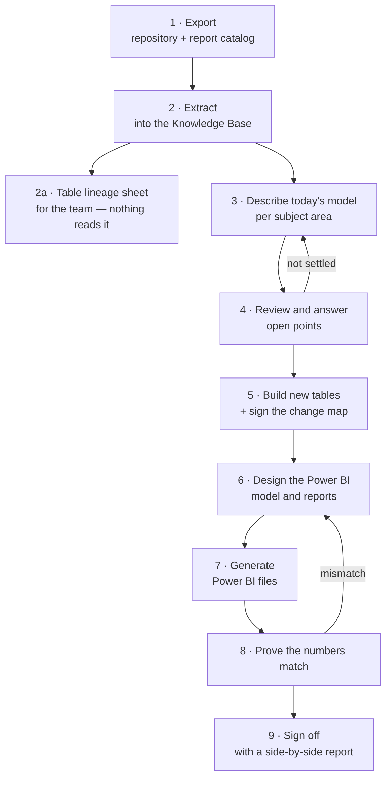

# Migration plan — OBIEE to Power BI on Azure

**What this covers:** how the migration runs from first export to a signed-off Power BI report — the stages, who does what, what each stage hands to the next, and what stops a stage from being called done.
**Who it is for:** anyone who needs the whole picture without reading the PRD, the architecture or the code.
**What it is not:** a schedule. It carries no dates or effort figures; those come once one subject area has been taken end to end.

It is drawn from the PRD, the epic roadmap and the list of asks in this folder, plus what the first as-is analysis run (Sample Sales, 18 November 2026) showed.

---

## 1. The plan in one paragraph

We export the OBIEE repository and report catalog once. A program reads them into a set of tables — the **Knowledge Base** — with no AI involved, so the same export always gives the same result. From there the work goes one subject area at a time: an assistant writes a plain-language description of what the model does today, business and technical owners answer its open questions, the tool drafts the scripts for the new Azure tables together with a map from old columns to new, Data Engineering corrects and signs both, the Power BI model and reports are designed and then generated, and every number is compared against OBIEE before the report is called migrated. **Nothing counts as migrated until its numbers match.**

## 2. Two migrations, not one

This is easy to miss and it changes the plan.

| | What moves | Who does it |
|---|---|---|
| **Data platform** | The warehouse tables, to Azure | Data Engineering — from table scripts the tool drafts |
| **Business intelligence** | The semantic model and the reports, from OBIEE to Power BI | This tool and its operator |

Because both move, a matching number has to prove two things at once: the new tables hold the same data, **and** the new model calculates the same result. It also means the description of today's model is not just documentation — it is the **requirements specification** Data Engineering builds from.

> The PRD was written assuming the warehouse stays put. That assumption no longer holds and the PRD needs updating to say so (open decision 1).

## 3. The stages

| # | Stage | Inputs needed | What comes out | Done when |
|---|---|---|---|---|
| 1 | **Export** | Access to the OBIEE server; Oracle's tool for converting the repository out of its binary format; the OBIEE version | The repository as files, and the report catalog as a folder | Both come from the **same** OBIEE instance |
| 2 | **Extract** | The exported repository and report catalog (stage 1), in one folder under one name for the estate | The Knowledge Base: every table, field, formula, join, hierarchy, variable and security rule, plus every report, its columns, filters and views | The error list is empty or every entry is explained; the list of things not understood has been read |
| 2a | **Table lineage sheet** | The Knowledge Base (stage 2) | One spreadsheet for the whole estate: every subject area traced through its business tables down to the database tables behind them, with aliases and views resolved. **A handout for the team; no later stage uses it** | Every business table in the estate appears in it; the team has it |
| 3 | **Describe** | The Knowledge Base (stage 2), with its error and gap lists read first | One plain-language document per subject area, with a numbered list of open points | Every gap is either closed from the Knowledge Base or written as a question someone can answer |
| 4 | **Review** | The draft document (stage 3); people who can answer its open points; a named reviewer | The same document, with answers filled in and corrections made | A named reviewer accepts it; no open point is left unanswered or unowned |
| 5 | **New tables and change map** | The reviewed document (stage 4); the target Azure platform and naming rules; table definitions from the old database, where available | Draft table scripts, and a list: *this old column is that new column* — both produced by the tool, both corrected and signed by Data Engineering | Data Engineering has signed every table and every row |
| 6 | **Design** | The reviewed document (stage 4); the signed table scripts and change map (stage 5); the report catalog content from the Knowledge Base; decisions on OBIEE features Power BI lacks | The **migration rules** (once), then a **design document** per group of reports | The design is reviewed by someone other than its author, before anything is built |
| 7 | **Generate** | The reviewed design document (stage 6); Power BI Desktop | Power BI project files, as text | They open in Power BI Desktop without repair |
| 8 | **Prove** | The generated Power BI files (stage 7); the signed change map (stage 5); read-only access to the old and the new data | A list of checks: passed, failed, could not run | Zero failures, or a recorded override with a reason |
| 9 | **Sign off** | The check results (stage 8); screenshots of the old and new reports; the report owner | A side-by-side report: old and new, tab by tab, with the number checks | The report owner accepts it |

### Stage notes

**1 · Export.** One-time, and nothing here needs a running OBIEE server afterwards. The repository must be converted from Oracle's binary format first; the catalog is copied as it is. If usage tracking is switched on, export that too — it shows which reports anyone actually opens, which decides what is worth migrating at all.

**2 · Extract.** A program, not an assistant. It keeps formulas character for character and never guesses: anything it cannot read is listed, not dropped. Two lists come out with it and both must be read — *errors* (something that should have been captured was not) and *known gaps* (content the program does not yet understand).

**2a · Table lineage sheet.** A side output, produced because the team needs it. **No later stage reads it** — stages 3 onward work from the Knowledge Base directly — so the plan does not depend on it and it can be re-run or skipped without affecting anything else. It comes from a second program run straight after extraction, again with no assistant involved. The Knowledge Base holds lineage field by field, which is too fine for planning; this folds it into one row per chain:

*subject area → business table (as report authors see it) → model table → source → database table*

and for each database table it says what it really is:

| Column | Tells you |
|---|---|
| Alias | The name OBIEE uses, when that is only a second name for another table |
| Original table | The table the alias stands for |
| Intermediate view | When the table is really a query written inside OBIEE |
| Final table | The query text for such a view; otherwise the table's actual name in the database |
| Comment | Left empty, for whoever works through the sheet |

What the team gets from it: the list of database tables the reports actually depend on, in one sheet they can filter and annotate, and an early view of which subject areas share tables.

Two limits. A query's text is shown as written, not broken down into the tables it reads. And a view that lives in the database, rather than in OBIEE, looks like an ordinary table here.

**3 · Describe.** The assistant works from the Knowledge Base, one subject area at a time, and writes for a reader who will not open the code: what questions the model answers, what each number means, how tables relate, where data comes from, and what differs per user. What it cannot establish becomes an open point with a named kind of person who can answer it.

**4 · Review.** This is where people who know the system correct the picture. A reviewer can challenge a single statement and have it re-checked on its own. Corrections must survive the document being regenerated.

**5 · New tables and change map.** The tool drafts the table scripts — one `CREATE TABLE` per table the reviewed model needs — and Data Engineering owns them from there: corrects, extends, and signs.

Drafting the scripts and the change map together has a real advantage. When the tool writes a new table from an old one, it knows which old column each new column came from, so the map is produced **by construction** rather than guessed afterwards from matching names. It is still a proposal until signed: **the tool proposes, Data Engineering declares.** The signed map does two jobs — it feeds the design, and each signed row becomes a number check in stage 8.

What the tool can and cannot put in a script:

| The repository gives us | The repository does not give us |
|---|---|
| Every table OBIEE knows about, and every column on it | Tables and columns that exist in the database but were never brought into OBIEE |
| Column types and lengths, as OBIEE believes them to be | Decimal places; whether a column may be empty, for many columns |
| Which tables are really queries (their SQL is captured) | What a database view does, when the view lives in the database rather than in OBIEE |
| Which tables relate to which, at the business-model level | Primary keys, and which column each foreign key points to — **not captured yet** (an extraction gap, fixable) |
| The level of detail each table is used at | Indexes, partitioning, volumes, and how tables are loaded |

So a drafted script is a correct **starting point for what the reports need**, not a finished design. The right-hand column is exactly what Data Engineering adds, and where the old database's own table definitions are available they close most of it.

**6 · Design.** Two documents. The **migration rules** are written once for the whole estate: how each OBIEE feature is carried into Power BI, so the same decision is not made differently on every report. The **design document** applies those rules to one group of reports and says what to build — tables, relationships, measures, hierarchies, security, and each report's tabs, visuals, filters and prompts. It lists what already exists and is reused, so the second report in a group does not rebuild the model and drift. Anything the tool is not qualified to decide is flagged for a person.

**7 · Generate.** The standard build assistant writes the Power BI files from the design. They are text, so changes can be reviewed line by line. The assistant that writes the design never builds from it — that separation is what keeps the review in stage 6 meaningful.

**8 · Prove.** A separate assistant whose job is to find the migration wrong. For every measure it runs the old query and the new one against real data — the overall total, at least one filtered slice, and the combinations the report actually shows — and compares within a stated tolerance. A check that could not run is reported as *could not run*, never as passed.

**9 · Sign off.** What the approver reads. It claims the same structure and the same data, **not** the same look: fonts, colours and chart styling will differ and are listed as expected. A difference in data, columns, filters or ordering is a defect.

## 4. What is done once, and what repeats

| How often | Work |
|---|---|
| **Once per estate** | Export · extract · table lineage sheet · migration rules |
| **Once per subject area** | Describe · review · new tables · change map |
| **Once per group of reports** | Design document |
| **Once per report** | Generate · prove · sign off |

The repeating unit matters for adoption: one report can be taken through on its own, so the approach can be tried without committing the whole estate to it.

## 5. Who does what

| Role | Responsible for |
|---|---|
| **Operator** | Runs the tool, reads the error and gap lists, steers each stage |
| **OBIEE owner** | The exports; answers on how the current model is meant to behave |
| **Business and report owners** | Answer open points about meaning; accept the final report |
| **Data Engineering** | Owns the new tables: corrects and **signs the drafted table scripts and the change map**; loads the data; explains how it is loaded |
| **Database owner** | Read-only access for number checks; table definitions |
| **Power BI owner** | Confirms the file format is permitted; later, workspaces and publishing |
| **Reviewer** | Accepts the stage 4 document and the stage 6 design — not the person who wrote them |

## 6. What we need from others

| Ask | From | Unlocks | Without it |
|---|---|---|---|
| Repository export | OBIEE owner | Everything | No start |
| Report catalog, **same instance** | OBIEE owner | Report-level logic; knowing which reports to build | Models can be described, reports cannot |
| OBIEE version | OBIEE owner | Confidence the export will be read correctly | Surprises show up in the gap list instead |
| Usage tracking data | OBIEE / database owner | Deciding what is worth migrating | Everything is migrated, used or not |
| Answers to open points | Business, OBIEE, Data Engineering | Stage 4 | Documents stay drafts |
| Target platform and naming rules | Data Engineering | Drafting table scripts in the right dialect and style (stage 5) | Scripts come out generic and need rewriting |
| Table definitions from the old database | Database owner | Keys, decimal places, empty-or-not — what OBIEE does not hold | Drafted scripts are thinner; more for Data Engineering to fill in |
| Signed table scripts and change map | Data Engineering | Stages 6 and 8 | No design, no checks |
| Read-only database access, both sides | Database owner | Stage 8 | **Nothing can be proven** |
| Power BI Desktop (Windows) | Power BI owner | Stages 7 and 8, locally | No way to open or query what was built |

Publishing rights, a premium workspace and a data gateway are **not** needed to prove the approach. They are needed when real users are given the reports.

## 7. How we know it is right

Three abandonment conditions. If any holds once reports are being generated, the approach has failed whatever else works:

1. **Accuracy is too low** — too many measures in a design are wrong on first expert review.
2. **Too many hours go into fixing output** — measured per report, against doing it by hand today.
3. **A defect reaches production** — a wrong number that the checks did not stop.

Two things are deliberately **not** chased: reports migrated per week, and lower running cost. Speed bought by loosening the number check turns the tool into a way of producing wrong reports faster.

## 8. Where we are today

| Stage | State |
|---|---|
| 1 Export | Not done for the real estate. Development has used public sample repositories and one sample catalog — **from different systems**, so no matched pair exists yet |
| 2 Extract | **Built**, in review. 39 tables out; reads both the repository and the catalog |
| 2a Table lineage sheet | **Built.** On the sample estate: 157 rows covering all 128 business tables |
| 3 Describe | **First draft produced** for one sample subject area. The run needed information beyond the per-subject-area extract, and exposed seven gaps in extraction that create avoidable open points |
| 4 Review | Not built. No way yet to challenge one statement, or keep corrections through regeneration |
| 5 Table scripts and change map | Not started. The tool does not draft scripts yet; keys are not extracted yet; the target platform is not chosen (open decision 9) |
| 6 Design | Not started |
| 7 Generate | Not started |
| 8 Prove | Not started. **Blocked** on database access to both sides |
| 9 Sign off | Not started |

The central claim — that migrated numbers match — is **unproven**. No migrated number has yet been compared with a legacy one.

## 9. Order of work

Take **one subject area end to end** before widening. Each stage has taught something that changed the next, and planning all of them in detail now would be planning on guesses.

1. **Get a real matched export.** The first repository and catalog from the same OBIEE instance. This is the first real test of everything built so far.
2. **Finish describing and reviewing** one subject area on that export, with real people answering real open points.
3. **Close the extraction gaps** that review exposes, so later documents ask fewer questions.
4. **Draft the table scripts and change map** for that subject area, and take them through Data Engineering's review.
5. **Write the migration rules** from what that subject area actually contains.
6. **Design, build and prove one report.** By hand first if need be — if a person can build a correct report from the design alone, generation is the smaller risk.
7. **Then widen**: more subject areas, then generation and automated checks at scale.

## 10. Risks worth naming

| Risk | Why it matters | What limits it |
|---|---|---|
| A gap in extraction goes unnoticed | A missing filter gives a plausible, wrong number | Everything unread is listed; the number check is the final net |
| The same measure gets defined twice, slightly differently | Trust in the whole estate goes | One estate-wide Knowledge Base; designs state what is reused |
| A less experienced operator works at speed | Ten flawed reports a day instead of one | Judgement is captured in the reviewed design; the number check is the backstop |
| "Looks like the old report" is heard as pixel-identical | A correct migration is rejected over a font | Sign-off report states the claim: same structure and data, not same look |
| The sample models are clean; the real estate is not | Works in rehearsal, fails on arrival | Hand-built awkward cases; accuracy reported per feature, not as one figure; real export tested early |
| The working environment cannot run the tool | Built but undeliverable | Needs only Python and plain files; a manual mode as fallback |
| OBIEE features with no Power BI equivalent | Design stalls report by report | Decided once in the migration rules (see open decision 4) |

## 11. Open decisions

These are for the project owner. Please write the decision under each.

**1. The warehouse is moving too.** The PRD assumes it stays. Confirm the plan above — two migrations, the as-is document as a requirements specification — and update the PRD.
*Decision:*

**2. Which estate, and which subject area, goes first?**
*Decision:*

**3. Can we get a repository and catalog from the same instance, and is usage tracking on?**
*Decision:*

**4. What happens to OBIEE features Power BI does not have?** Found so far in one sample model: several summary tables behind one measure; a per-user currency setting; field names translated per user at login; **users typing values back in** (Power BI has nothing built in); joins that silently drop unmatched rows; a manager-and-reports hierarchy. Each needs a rule: reproduce, replace, or retire.
*Decision:*

**5. Is the text-based Power BI project format permitted here?** The plan depends on it; it has not been confirmed.
*Decision:*

**6. Who reviews?** Stage 4 and stage 6 each need a named reviewer who is not the author.
*Decision:*

**7. How will the old numbers be obtained for checking** — by querying OBIEE, or the old warehouse directly? And for how long will the old system stay available to compare against?
*Decision:*

**8. Is the project's own content acceptable in version control?** The review loop is built on documents kept in git, where every correction is a visible change.
*Decision:*

**9. What are the table scripts written for?** Which Azure platform (and so which SQL dialect and column types), and whose naming rules. Also: do the new tables keep today's shape — including the three revenue summary tables — or is the model redesigned on the way? Drafting scripts for a like-for-like copy is mechanical; drafting a redesign is a design task and needs its own rules.
*Decision:*
